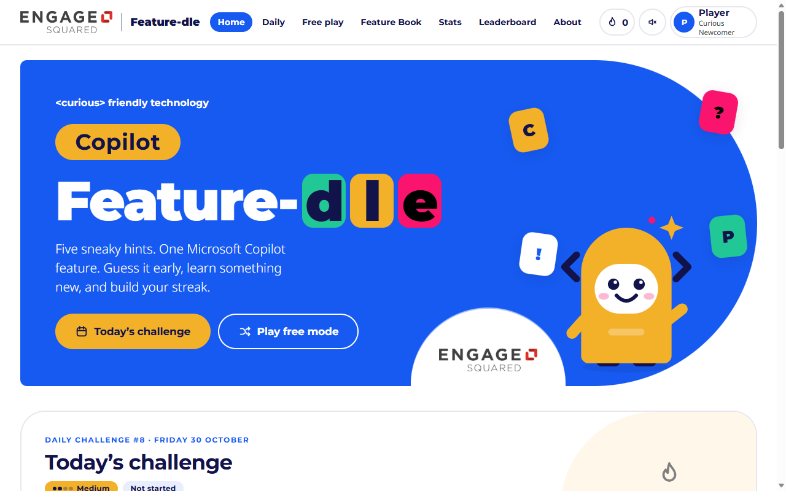
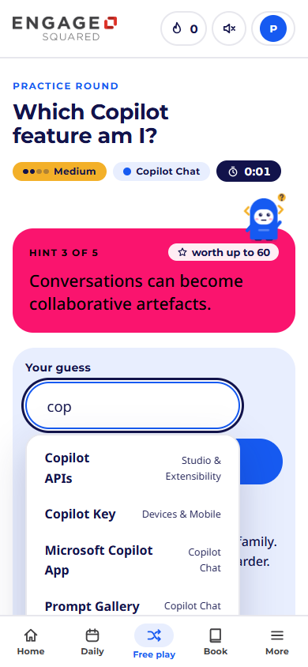
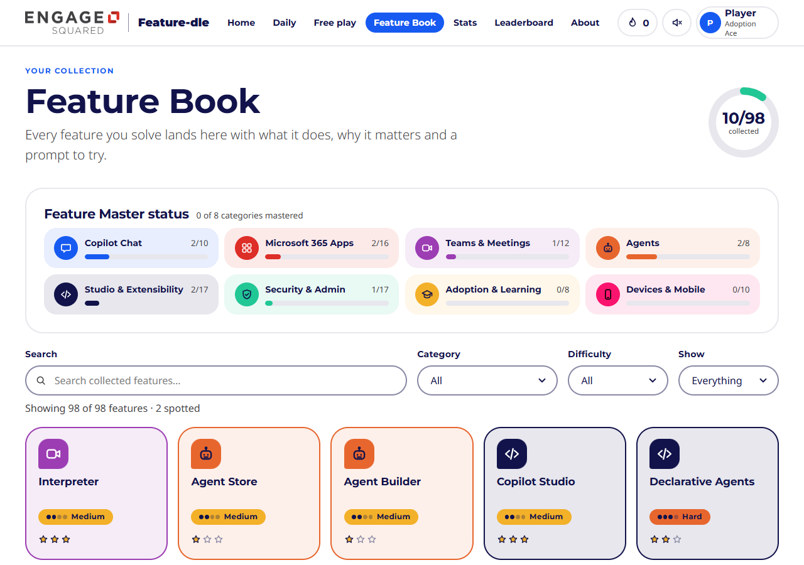
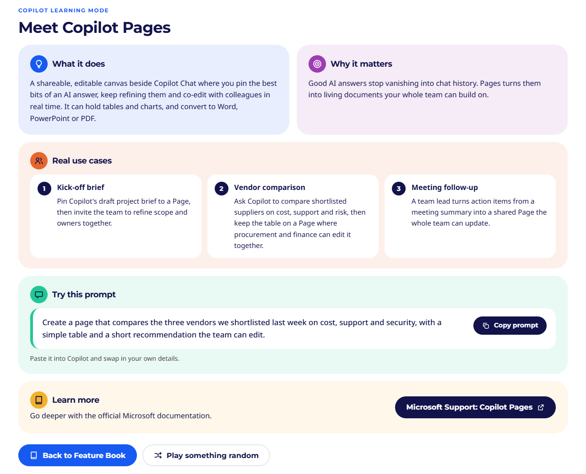

# Copilot Feature-dle

> **&lt;people&gt; friendly technology** · by [Engage Squared](https://www.engagesquared.com)

A friendly, Wordle-style guessing game that helps people get to know **Microsoft Copilot**. Players get five deliberately sneaky (but accurate) hints about a Copilot feature, guess it, and then learn what it does, why it matters, three real use cases and a prompt to try.

### ▶ Play it: **https://liame2.github.io/copilot-feature-dle/**

Works on phones and desktops, installs like an app and keeps working offline.

<p align="center">
  
</p>

<p align="center">
  
  &nbsp;&nbsp;&nbsp;
  
</p>

It is a plain HTML/CSS/JS web app: no build step, no framework, no backend. It runs from a folder, from any static host, as an installable offline PWA, or as a single portable HTML file.

---

## Quick start

| I want to… | Do this |
|---|---|
| **Just play** | Open **https://liame2.github.io/copilot-feature-dle/**. Use your browser's *Install* / *Add to Home screen* option for an app-like, offline-ready copy. |
| **Play offline or send it to someone** | Download **`Copilot-Feature-dle.html`** from this repo (open it on GitHub and click *Download raw file*) and double-click it. Everything is inside that one file and it never contacts a server. |
| **Run the full app locally** | `powershell -ExecutionPolicy Bypass -File tools\serve.ps1 -Open` then browse to `http://localhost:8080` (no Node or Python needed). |
| **Host it for an event or the whole company** | Copy this folder to any static host (GitHub Pages, Azure Static Web Apps, an Azure Storage static website, SharePoint-hosted site, IIS…). Serve it over **https** for the PWA and offline features. See [Publishing](#publishing-to-github-pages). |
| **Run a live leaderboard in a room** | `tools\serve.ps1 -Lan` (as administrator), then share `http://<your-ip>:8080/?event=MYEVENT`. See [Leaderboards](#leaderboards). |

> Opening `index.html` straight from disk also works (the data falls back to `data/features.js`), but fonts, the share-image download and offline caching are best from the single-file edition or a web server.

---

## What's in the box

**Game modes**
- **Daily Challenge**: one feature per day, the same for everyone (by local date), with a shareable results card, win streaks and a stats dashboard. Difficulty ramps through the week (Easy Mon/Tue → Medium Wed–Fri → Hard Sat → Expert Sun).
- **Free play**: unlimited practice with difficulty / category / pack filters and difficulty unlocks.
- **Speed round** (timed challenge): 3 minutes, as many features as you can name.
- **Team battle**: pass-and-play for workshops and lunch-and-learns; teams take turns, wrong guesses unlock easier hints and pass the turn. Great on a projector.
- **Friend challenges**: copy a link that challenges someone with a specific feature (`#/c/<code>`).

**Gameplay**
- 5 hints that get easier after each miss; a **hint-o-meter**, **guesses left**, live **score** and **name-shape** reveal (category at hint 3, word lengths at hint 4, first letters at hint 5).
- **Hot / warm / cold** feedback on wrong guesses (like Worldle's distance clue): same category? easier or harder? closely related?
- **Fuzzy matching**: full names, aliases ("Pages" = "Copilot Pages"), plurals, missing spaces, transposed letters and typos all work, plus ARIA autocomplete suggestions. An ambiguous guess such as "Wave" asks you to be more specific instead of costing a guess.
- **Nudge** (spend a guess to reveal the next hint) and **give up** (reveals the answer, still teaches).

**Copilot Learning Mode** after every game: *What it does · Why it matters · Real use cases (3) · Example prompt (copy button) · Microsoft Learn link.*

<p align="center">
  
</p>

**Gamification**: points, speed bonus, streak multipliers, XP, 7 ranks up to **Copilot Champion** and **Copilot Legend**, 31 achievement badges (including a **Feature Master** badge for every category), the **Feature Book** collection, daily streaks, difficulty unlocks and progress tracking.

**Packs and extras**: Wave 2 / Wave 3 packs, a **Build Special Edition**, monthly spotlights, **community packs** and an **AI-generated pack** workflow (copy a prompt, let Copilot draft a pack, paste the JSON, review, play).

**Platform**: responsive, keyboard navigable, WCAG 2.2 AA tested, reduced-motion and high-contrast modes, larger-text option, relaxed (no-timer) mode, local storage with an in-memory fallback, installable PWA with offline play, shareable URLs.

---

## The library at a glance

**98 features**, each with five hints, a plain-English explanation, why it matters, three use cases, an example prompt and a Microsoft documentation link (every link was checked on 23 Oct 2026).

| Difficulty | Easy | Medium | Hard | Expert |
|---|---|---|---|---|
| Features | 12 | 27 | 38 | 21 |

| Category | Features | Category | Features |
|---|---|---|---|
| Copilot Chat | 10 | Studio & Extensibility | 17 |
| Microsoft 365 Apps | 16 | Security & Admin | 17 |
| Teams & Meetings | 12 | Adoption & Learning | 8 |
| Agents | 8 | Devices & Mobile | 10 |

Packs: **Core** 98 · **Wave 2** 12 · **Wave 3** 6 · **Build Special Edition** 20. Twelve monthly spotlights pick features by tag.

---

## Scoring in one glance

| Hints used | 1 | 2 | 3 | 4 | 5 |
|---|---|---|---|---|---|
| Points | 100 | 80 | 60 | 40 | 20 |

- **Speed bonus**: +20 (≤20 s), +15 (≤40 s), +10 (≤60 s), +5 (≤120 s) of active play time (off in *relaxed timing*).
- **Streak multiplier**: +10% per win already in a row, capped at ×2.0.
- **XP** = score + difficulty bonus (0/10/25/50) + 15 for a new feature + Daily bonuses; a miss still earns 5 XP.
- **Ranks**: Curious Newcomer → Prompt Explorer → Feature Finder → Workflow Wizard → Adoption Ace → **Copilot Champion** → Copilot Legend.
- **Unlocks** (Free play only): Medium after 3 Easy features, Hard after 5 Medium, Expert after 5 Hard (or switch on *Facilitator mode*).

All numbers live in `js/05-config.js`.

---

## Adding or editing features

The whole library is one file: **`data/features.json`**. Add an object to `features`, then run the build script.

```json
{
  "id": "copilot-pages",
  "name": "Copilot Pages",
  "aliases": ["Pages", "Copilot Page"],
  "difficulty": "Medium",
  "category": "Copilot Chat",
  "tags": ["collaboration", "creation"],
  "packs": ["core", "wave-2"],
  "introduced": "2024-09",
  "hints": [
    "I collect ideas, but I'm not OneNote.",
    "I help preserve AI-generated work.",
    "Conversations can become collaborative artefacts.",
    "I turn chat responses into something your team can edit.",
    "My name suggests somewhere information can live."
  ],
  "description": "What it does, in 1-2 plain sentences.",
  "why": "Why it matters at work.",
  "useCases": [ { "title": "Kick-off brief", "text": "A concrete scenario." }, { "title": "…", "text": "…" }, { "title": "…", "text": "…" } ],
  "prompt": "An authentic prompt someone could paste into Copilot.",
  "learnMore": "https://learn.microsoft.com/…",
  "learnLabel": "Microsoft Learn: Copilot Pages",
  "related": ["copilot-notebooks"]
}
```

| Field | Notes |
|---|---|
| `name`, `hints` | Required. Provide 3-5 hints (5 is ideal; the game pads missing ones with simple clues). Keep the name out of hints 1-3. |
| `difficulty` | `Easy` · `Medium` · `Hard` · `Expert`. Drives the Daily weekday ramp, unlocks and XP. |
| `category` | Must exist in `categories` (name, colour, icon). |
| `tags` | Free-form lowercase words. Used for monthly spotlights and the "warm" clue. |
| `packs` | `core` (daily + free play), plus any pack id from `packs`. |
| `daily` | Set to `false` to keep a feature out of the Daily Challenge (it stays in Free play). |
| `related` | Ids that players commonly mix it up with (gives a "hot" clue). |
| `aliases` | Other names players might type. Brand prefixes ("Copilot", "Microsoft 365") and plurals are handled automatically. |

Also in `features.json`: `categories`, `packs`, `themes` (monthly spotlights: `month` + `tag`), and `schedule` (pin any date to any feature, e.g. `"2026-11-04": "copilot-studio"`).

**After editing, run:**

```powershell
powershell -ExecutionPolicy Bypass -File tools\build.ps1            # validate, refresh data\features.js and the offline cache list
powershell -ExecutionPolicy Bypass -File tools\build.ps1 -Single -ShareUrl https://liame2.github.io/copilot-feature-dle/   # ...and rebuild Copilot-Feature-dle.html
powershell -ExecutionPolicy Bypass -File tools\check-links.ps1      # confirm every Learn link still opens
powershell -ExecutionPolicy Bypass -File tools\format-json.ps1      # keep features.json tidy (safe: refuses to change any content)
```

The build tool validates the schema (duplicate ids, missing hints/use cases, unknown categories, hints that give the name away, alias clashes…) and prints the difficulty and category mix. **Always run it before committing**, so `data/features.js` and the offline cache list stay in step with `features.json`.

`-ShareUrl` puts your public address on share cards and links made from the single file, which has no web address of its own.

### How the Daily Challenge rotates

Each difficulty cycles through its own shuffled list, so nothing repeats until that list is used up. The Daily draws on the features that aren't marked `"daily": false` (currently 67: 10 Easy, 23 Medium, 23 Hard, 11 Expert), which means an Easy feature comes back about every **5 weeks**, Medium every **8**, Expert every **11** and Hard every **23**. Add more features to stretch that out.

### Community and AI-generated packs (no files needed)
Players can open **Packs & themes**, copy the ready-made Copilot prompt, paste the JSON Copilot returns, check it (friendly validation messages) and add it. Packs are stored on the device and can be played from Free play. Always fact-check anything generated by AI before using it in a session.

---

## Leaderboards

1. **On this device (default).** Everyone who has played on the device is ranked (great for a shared laptop: *Who's playing?* lets you add players). Clearly-labelled **sample players** keep the board lively; turn them off in Settings.
2. **Live event board.** `tools\serve.ps1` also exposes `/api/leaderboard`. Run `tools\serve.ps1 -Lan` as administrator, share `http://<your-ip>:8080/?event=LUNCH26` and everyone who opens the link joins the same Daily board (scores post automatically after each daily game). Data is saved to `tools\leaderboard-data.json` (git-ignored, because it holds player names).
3. **Your own endpoint.** Set `leaderboard: { endpoint, eventCode }` in `js/05-config.js` (an Azure Function, Power Automate HTTP flow, SharePoint list front-end…):
   - `POST {endpoint}` with JSON `{ eventCode, date, playerId, name, color, today:{score,hints,timeMs,won}, maxStreak, totalScore, bestScore, played }` → `200`.
   - `GET {endpoint}?eventCode=…&date=YYYY-MM-DD` → `{ "players": [ { playerId, name, color, today|null, maxStreak, totalScore, bestScore, played } ] }`.

   The client never blocks or fails if the endpoint is down. An event link can only point the board at the **same site** it was opened from.

GitHub Pages is static hosting, so it can't run a live board by itself: on the public link, scores stay on each player's device. Use option 2 or 3 for rooms.

Scores are self-reported by the browser, so treat shared boards as friendly fun, not an audit trail.

---

## Branding

The look follows the *Engage Squared Brand Guidelines*: Montserrat Bold headings and Noto Sans body (Calibri fallback, fonts self-hosted so offline play looks right), the exact palette (`#DD2E27 #F3B029 #E7662E #9C3DB3 #165AF1 #12134B #FA146E #21C795 #000000 #414042`) and the official 75 / 50 / 10% tints, the pill / arch shapes and white logo "tab" from the collateral, and the `<people> friendly technology` device. Text/background pairs follow the guidelines' WCAG AA combinations (e.g. white on blue, navy on yellow, black on pink). The brandmark in `assets/img` is the official artwork extracted from the guidelines PDF; keep its clear space and don't recolour it.

Pip, the game's bracket-eared guide, and the "Feature-dle" wordmark are original artwork for this game.

---

## Accessibility

Skip link, landmarks, ARIA 1.2 combobox with live announcements, focus rings that work on every background, 44 px touch targets, no colour-only meaning (icons + text for hot/cold, easier/harder), reduced motion (device setting or override), high contrast mode, text size options, relaxed timing (no clock, no speed bonus, double time in Speed round).

Automated checks run **axe-core (WCAG 2.2 A/AA)** against all 11 screens plus the game states and dialogs (fresh hint card, autocomplete open, after a wrong guess, result and Learning Mode, Feature Book detail, player dialog), with 0 violations at the time of writing. Run them in Chrome or Edge with the local server running: open `http://localhost:8080/tests/e2e.html?axe=1` and wait for the tab title to change to **DONE OK**.

---

## Security and privacy

- **No accounts, no analytics, no third-party requests.** Fonts and images are self-hosted. Progress is stored only in the browser's `localStorage` under `copilot-feature-dle.v1`.
- **Content Security Policy.** The hosted app only loads scripts, styles, images and data from its own site. The single-file edition cannot make any network connection at all.
- **Imported content is untrusted.** Community packs and backups are validated and cleaned before use: only plain `https://` links are kept, odd colours and ids are dropped, and all text is escaped when it is shown.
- **Live event boards.** Event links can only target the same site. `tools\serve.ps1` validates and bounds everything it accepts, caps the number of events and players, and never serves the `tools` folder or dotfiles.
- **Shared origin.** Every GitHub Pages project under one account shares a browser origin, so this game uses its own storage key and cache prefix. Tests and demos run in a separate save slot (`?ns=test`) and can never touch a real player's progress.

---

## Publishing to GitHub Pages

This repo is published from the `main` branch (root). To publish your own copy:

1. Fork or copy the repo, then go to **Settings → Pages → Build and deployment → Deploy from a branch → `main` / `(root)`**.
2. Wait about a minute, then open `https://<your-account>.github.io/<repo-name>/`.
3. If you host somewhere other than `liame2.github.io/copilot-feature-dle`, update the address in the `og:image` tag in `index.html` (it's what link previews in Teams and chat apps show) and use your own address with `-ShareUrl` when you build the single-file edition.

**To update the live game:** edit `data/features.json` → run `tools\build.ps1` (add `-Single -ShareUrl …` to refresh the single file) → commit → push. Pages redeploys in about a minute. Installed copies pick up the new version when they're next opened online (the shell updates straight away; styles and scripts refresh in the background, so occasionally it takes a second visit).

---

## Project layout

```
index.html            app shell          manifest.webmanifest, sw.js   PWA
Copilot-Feature-dle.html   the single-file edition (built by tools\build.ps1 -Single)
css/                  base · components · views · pages
js/                   00 core · 05 config · 10 icons+Pip · 20 data · 30 matching · 40 scoring+badges · 50 store
                      55 leaderboard · 60 daily · 70 game engine · 80 share · 85 confetti/sound · 90 UI kit/router
                      91-98 views · 99 boot
data/features.json    the library (edit me)         data/features.js   generated mirror for file://
assets/               fonts (OFL, licences included), Engage Squared logos, app icons
docs/                 screenshots for this README and the link-preview card
tools/                serve · build · check-links · format-json · test · shot/scene · make-icons
tests/                e2e.html (unit + end-to-end + axe) · scenario.html (screenshot driver) · vendor/axe.min.js
```

## Developer tools (PowerShell only)

| Script | Purpose |
|---|---|
| `tools\serve.ps1` | Static server + live event leaderboard |
| `tools\build.ps1 [-Single] [-ShareUrl …]` | Validate the library, regenerate `features.js`, refresh `sw.js`, build the single-file edition |
| `tools\check-links.ps1` | HTTP-check every Learn link |
| `tools\format-json.ps1 [-Check]` | Tidy `features.json` (2-space indent, readable hints) without changing any content |
| `tools\test.ps1` | Headless Chrome/Edge run of `tests\e2e.html` (matching, scoring, daily rotation, full game flows, security checks). Needs the server on port 8765 |
| `tools\scene.ps1`, `tools\shot.ps1` | Responsive screenshots of any screen or game state |
| `tools\make-icons.ps1` | Regenerate PWA icons |

## Known limits

- Sandboxed previews that block storage/network (for example some OneDrive/SharePoint in-browser HTML previews) run the game without saving progress. Open the file locally or use the hosted link for the full experience.
- Daily Challenge uses the player's **local** date, so players in different time zones roll over at their own midnight.
- Offline caching and the share-image download need https (or the single-file edition).
- The public link keeps scores per device; a shared live board needs `tools\serve.ps1` or your own endpoint.

## Fact-check notes

Features were researched against Microsoft documentation in **October 2026** and Copilot changes fast. These were flagged as lower-confidence when the library was written, so double-check them before using them in a customer session:

- **Copilot Tuning**: early-access capability.
- **Employee Self-Service agent** and the **Agents SDK** general-availability date.
- **Copilot Control System**: the 2026 rename to "Copilot controls" was inferred from Microsoft's documentation structure.
- **Windows Recall**: documented as a preview at the time.
- **Intelligent Recap**: audio and video recap availability depends on licence and preview status.

When in doubt, the *Learn more* link on each feature goes to the official page. Re-run `tools\check-links.ps1` and review the library regularly.

## Third-party notices

- **Montserrat** © The Montserrat Project Authors and **Noto Sans** © The Noto Project Authors, under the [SIL Open Font License 1.1](https://openfontlicense.org). The licence texts sit next to the font files in `assets/fonts/`.
- **axe-core** 4.10.2 © Deque Systems, under the Mozilla Public License 2.0. It is only used by the tests (`tests/vendor/axe.min.js`, with its original notice intact).
- The **Engage Squared** name, logo and brand guidelines belong to Engage Squared and are used here for Engage Squared's own material. They are not offered for reuse.
- *Copilot Feature-dle is an independent learning game and is not affiliated with or endorsed by Microsoft. Microsoft, Microsoft 365, Copilot, Teams, Word, Excel, PowerPoint, Outlook, OneNote, SharePoint and other names are trademarks of the Microsoft group of companies.*
- No open-source licence file is included yet. Until Engage Squared chooses one, the default copyright rules apply.
