# Copilot Feature-dle

> **&lt;people&gt; friendly technology** · by [Engage Squared](https://www.engagesquared.com)

A friendly puzzle game that helps people get to know **Microsoft Copilot**, one clue at a time. Every Copilot feature can be learned three ways, one for each game mode: **Feature Hunt** (five deliberately sneaky but accurate hints: *Know it*), **Scenario Match** (a real work scenario: *Use it*) and **Prompt Lab** (four prompts: *Prompt it*). The **Feature Book** brings all three together for every feature, with prompts to try and a link to Microsoft's own documentation.

### ▶ Play it: **https://liame2.github.io/copilot-feature-dle/**

Works on phones and desktops, installs like an app and keeps working offline.

<p align="center">
  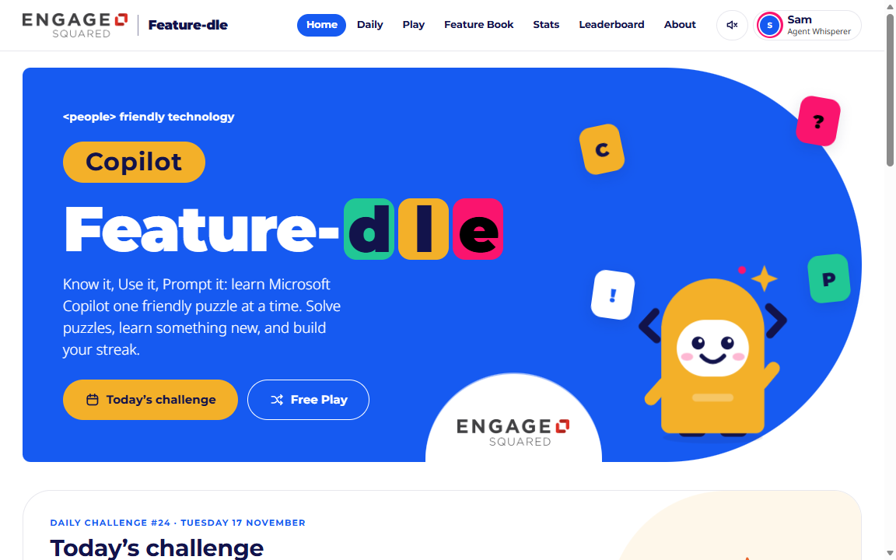
</p>

<p align="center">
  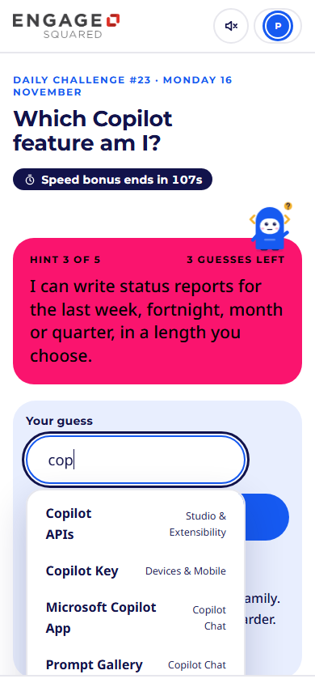
  &nbsp;&nbsp;&nbsp;
  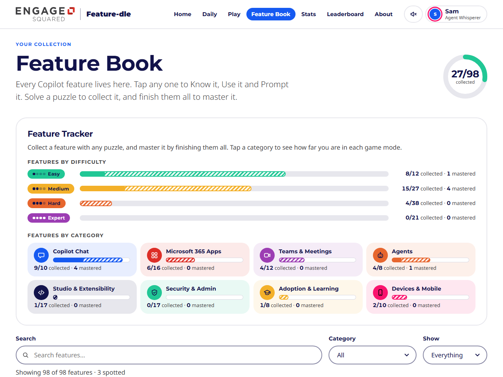
</p>

It is a plain HTML/CSS/JS web app: no build step, no framework, no backend. It runs from a folder, from any static host, as an installable offline PWA, or as a single portable HTML file.

---

## Quick start

| I want to… | Do this |
|---|---|
| **Just play** | Open **https://liame2.github.io/copilot-feature-dle/**. Use your browser's *Install* / *Add to Home screen* option for an app-like, offline-ready copy. |
| **Play offline or send it to someone** | Use **`Copilot-Feature-dle.html`** (open it on GitHub and click *Download raw file*, or share the file from this folder) and double-click it. Everything is inside that one file and it never contacts a server. |
| **Run the full app locally** | `powershell -ExecutionPolicy Bypass -File tools\serve.ps1 -Open` then browse to `http://localhost:8080` (no Node or Python needed). |
| **Host it for an event or the whole company** | Copy this folder to any static host (GitHub Pages, Azure Static Web Apps, an Azure Storage static website, SharePoint-hosted site, IIS…). Serve it over **https** for the PWA and offline features. See [Publishing](#publishing-to-github-pages). |
| **Run a live leaderboard in a room** | `tools\serve.ps1 -Lan` (as administrator), then share `http://<your-ip>:8080/?event=MYEVENT`. See [Leaderboards](#leaderboards). |
| **Change what the "What's new" popup says** | Edit `data/changelog.json` and run `tools\build.ps1`. See [The welcome and the "What's new" popup](#the-welcome-and-the-whats-new-popup). |
| **Choose which puzzle is the Daily Challenge on a given day** | Edit `data/daily.json` and run `tools\build.ps1`. Any day you haven't planned uses the random rotation. See [Planning the Daily Challenge](#planning-the-daily-challenge). |
| **Add or change Scenario Match scenarios** (they are each feature's example scenarios too) | Edit `data/scenarios.json` and run `tools\build.ps1`. See [Scenario Match](#scenario-match). |
| **Add or change Prompt Lab scenarios** | Edit `data/prompts.json` and run `tools\build.ps1`. See [Prompt Lab](#prompt-lab). |
| **Let people sign in with Microsoft** | Register an app in Microsoft Entra ID, paste its client ID into `js/05-config.js`, and publish. See [Microsoft sign-in](#microsoft-sign-in). |

> Opening `index.html` straight from disk also works (the data falls back to `data/features.js`, `data/changelog.js`, `data/daily.js`, `data/prompts.js` and `data/scenarios.js`), but fonts and offline caching are best from the single-file edition or a web server.

---

## What's in the box

**Three game modes** (every Copilot feature has all three layers: **Know it**, **Use it** and **Prompt it**)
- **Feature Hunt** (*Know it*): five hints that get easier after each miss, guess the Copilot feature. Choose a difficulty (every level is open from the start) and one or more categories, or leave them on **Any** and *All categories* and let Pip pick, and there is a *Prioritise features I haven't solved yet* option. Play **one hunt or up to 10 in a row**: the **Rounds** slider (1 to 10, 5 to start with) sets how many, and a game of two or more rounds ends on a results page (see [Rounds in Free Play and Feature Hunt](#rounds-in-free-play-and-feature-hunt)). A game you leave unfinished is kept: come back to **Feature Hunt** and choose **Resume game** or **Start a new game**.
- **Scenario Match** (*Use it*): a real work scenario in the first person (*"I want to search the web and multiple internal documents at the same time."*) and four Copilot features. Pick the one that fits best; a weaker pick explains what that feature is really for, and you can try again for fewer points. You get **three picks**, worth **50, 30 and 10 points**, and if all three are weaker it is a **miss**: no points, the answer is shown and the question goes to **Needs Another Look**. See [Scenario Match](#scenario-match).
- **Prompt Lab** (*Prompt it*): read a scenario, pick the best of four prompts, and see why. It has the same three picks and the same 50 / 30 / 10 points. See [Prompt Lab](#prompt-lab).

<p align="center">
  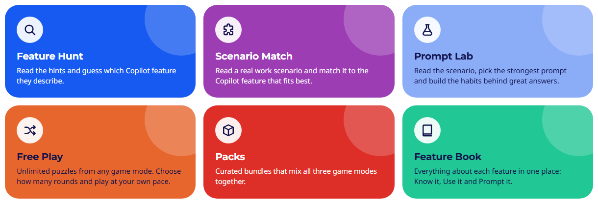
</p>

**Ways to mix them**
- **Daily Challenge**: one puzzle per weekday, the same for everyone (by local date), numbered by weekday (Friday #29 is followed by Monday #30). It can be a Feature Hunt, a Scenario Match question or a Prompt Lab question: from 17 November 2026 every group of three weekdays holds one of each, in a random order. There is no weekend puzzle, and a weekend never breaks your streak. Each day's difficulty is random, with a balanced mix over time, unless you choose the day's puzzle yourself in `data/daily.json`. The Daily Challenge is the only place with a **Speed Bonus** and the only game whose Feature Hunt shows a stopwatch chip, and its clock keeps running if you leave the screen. See [How the Daily Challenge works](#how-the-daily-challenge-works).
- **Free Play**: unlimited puzzles from **any game mode**, at your own pace. Tick the game modes you want (at least one stays ticked), choose a difficulty (**Any**, or one level: every level is open from the start) and one or more categories, set the **Rounds** slider (**1 to 10**, 5 to start with) and press **Surprise me**. Each round deals one puzzle from the ticked game modes, never the same one twice in a game: a Feature Hunt puzzle scores its points (100 down to 20, with no Speed Bonus) and a Scenario Match or Prompt Lab question scores 50, 30 or 10 over its three picks (a miss after three weaker picks scores nothing and goes to Needs Another Look). **One round** is a single puzzle that ends with the full answer and **Play again**; **two or more rounds** add a round meter, a **Next round** button after each puzzle (**See my results** after the last) and a results page that lists every puzzle you played; tap any of them to see everything about its feature. See [Rounds in Free Play and Feature Hunt](#rounds-in-free-play-and-feature-hunt).
- **Packs**: themed sets of puzzles, and **each pack mixes all three game modes**: a Feature Hunt puzzle for each feature, a Scenario Match question for each (its first scenario) and the Prompt Lab questions about it. So **Copilot Essentials** (12 features) holds 12 Feature Hunt + 12 Scenario Match + 22 Prompt Lab puzzles, and the Core library holds all 98 features with 98 scenarios and every Prompt Lab question. A question about a feature only comes up **after that feature's puzzle** (or once you have collected the feature), so its name never gives the answer away. A **Made for you** row sits at the very top, but only while there is something in it: it holds [Needs Another Look](#needs-another-look), the puzzles you missed, as one slim row with a **Play N** button. Next come the **official packs** (Copilot Essentials, Core, Wave 2, Wave 3, Build Special Edition) in **one sideways row**: three packs in full on a desktop, two on a tablet and one on a phone, with the next pack **peeking in at the edge** so it is clear there is more. Browse with the **arrows** (which say *1–3 of 5*) or by **swiping or scrolling**; the row snaps from pack to pack, and each pack you can see keeps its progress bar and its **Play** / **Resume progress** buttons. Then come the **monthly spotlights** as one long row for each month, with a **year toggle** that only moves between years that have spotlights. Every pack and spotlight shows its progress bar, how many puzzles you have played (*12 of 46 played*) and what it is made of (*12 Feature Hunt + 12 Scenario Match + 22 Prompt Lab*), with a **Next puzzle** button and **Resume progress** / **Start again** options. A puzzle you have already played is not offered again until you finish the pack, and a puzzle you leave half-played waits for you, exactly as you left it. A question in a pack counts like a round of its own game mode: its points are XP, and one you miss in three picks goes to Needs Another Look (it still counts as played in the pack). A pack or spotlight can choose its own questions (see [Packs](#packs)).

The play modes always run in this order: **Free Play, Feature Hunt, Scenario Match, Prompt Lab, Packs** (five pills along the top of each play screen). The home screen's **Ways to play** has **six tiles**: the three game modes across the top (**Feature Hunt**, **Scenario Match** and **Prompt Lab**), then **Free Play**, **Packs** and the **Feature Book**. Mode names (and **Your Stats**) are written in Title Case everywhere in the game, and a test checks it. **There is no timer and no timed round any more**: the old Speed Round (which later became Free Play's Timer) has gone, and the old `#/speed` link opens Free Play. **Team Battle has been retired** too: Free Play with a few rounds works well for a group around one screen, and the old `#/team` link opens Free Play.

<p align="center">
  
</p>

<p align="center">
  
</p>

**Unfinished games.** Leave a Feature Hunt, Free Play, pack, Scenario Match or Prompt Lab game and it waits on that mode's own screen, behind **Resume game** (or **Resume progress** for a pack) and **Start a new game**. The home page deliberately doesn't list them, to keep it calm. A Feature Hunt, Free Play, Scenario Match or Prompt Lab game waits for two weeks (its clock is paused while you are away), and a pack game as long as you like.

**Gameplay**
- 5 hints that get easier after each miss; a **hint-o-meter**, **guesses left**, a live **score** (with a **Speed Bonus** line on the Daily Challenge only) and **Pip's extras** (all three are plain white cards). The extras unlock one by one: the **category at hint 3**, the **name shape at hint 4** and the **first letters at hint 5**. Locked extras say when they unlock. At hint 5 the First letters callout is just a tick (the letters show in the name-shape tiles), and a long word shrinks its tiles so the card always fits its column.
- **What "category" and "level" mean:** on a guess, hover, focus or tap **Same category** / **Different category** or **Same level** / **Answer is harder** / **Answer is easier** to see a short definition of what a category or a level is (the same for every guess, so it never gives the answer away; the level wording lives in `levelInfo` in `js/05-config.js`).
- **Hot / warm / cold** feedback on wrong guesses (a distance-style clue): same category? easier or harder? closely related?
- **Fuzzy matching**: full names, aliases ("Pages" = "Copilot Pages"), plurals, missing spaces, transposed letters and typos all work, plus ARIA autocomplete suggestions. An ambiguous guess such as "Wave" asks you to be more specific instead of costing a guess.
- **Nudge** (spend a guess to reveal the next hint) and **give up** (reveals the answer, still teaches).
- **Clocks**: the **Daily Challenge** clock is real elapsed time and keeps running if you leave the screen, switch tabs or close the app (the challenge still ends at your local midnight), and the Daily is the only game that shows it on screen (as a stopwatch chip on a Feature Hunt). **Every other game** keeps time quietly (for your stats and the Quick Draw badge): its clock only runs while the game is on screen, leaving pauses it, and coming back carries on from the same second. There is no countdown and no timed round. See [Timers](#timers).

**When a game ends**, the page reads top to bottom: the **answer block** (the acknowledgement, answer and score), then your **hints and guesses** side by side (hint 1 lines up with guess 1, and so on, so each pair is the same height), then **Copilot Learning Mode**. Win or lose, the hint-o-meter and Pip's extras are tucked away (they have done their job), so the hints and guesses are all that is left beside the answer.

**Copilot Learning Mode** (after a Feature Hunt, and on the Daily Challenge when it is a question) shows the same thing as the Feature Book popup: three small **trackers** (*Know it · Use it · Prompt it*, each with a pie and how far you are), then a section for each layer: **Know it** (*What it does · Why it matters*), **Use it** (*Example scenarios*: the first 3, with a *See all N in the Feature Book* link) and **Prompt it** (one list of prompts to copy, every one of them shown: the feature's starter prompt first, *Try this prompt*, then the best prompt from each of its Prompt Lab scenarios, each with **Copy prompt** at its top right), and a **Learn more** link to Microsoft's documentation.

<p align="center">
  
</p>

**Gamification**: points, a **Speed Bonus** on the Daily Challenge, XP, **8 ranks** up to **Copilot Champion** (12,000 XP), **53 achievement badges** (a **Category Master** badge for every category and a **Feature Master** badge for mastering every feature, some harder ones, and some for games of rounds in Free Play and Feature Hunt, Packs, Needs Another Look, Scenario Match, Prompt Lab, using all three together and Pip), the **Feature Book** collection, a Daily streak that earns bonus XP and progress tracking. Every difficulty level is open from the start, in every game mode. Every rank has its own **border around the player's icon**, and **Copilot Champion** has a rotating, softly glowing rainbow border in the Copilot colours. Moving up a rank brings a celebratory popup. In a game with several rounds (a Free Play or Feature Hunt game of two or more rounds, a Scenario Match game or a Prompt Lab game) the popup waits until the game is over, or until you leave it, so it never interrupts a round (badge toasts still show straight away). The full list of badges (with what each one asks for) is on the Stats page and in `js/40-scoring.js`; these are the ones that follow the newer rules:
- **Five Alive** (solve 5 puzzles in one Free Play or Feature Hunt game), **Round Regular** (finish 5 Free Play or Feature Hunt games of 3 or more rounds) and **Clean Sweep** (solve all 10 in a 10-round game). They replace the three badges of the old timed rounds, so there are still 53.
- **Mode Explorer**: try every game mode and way to play (Feature Hunt, Scenario Match, Prompt Lab, Free Play and Packs).
- **Perfect Score**: solve a Daily Challenge Feature Hunt from the first hint in under 15 seconds, the top Speed Bonus and the most points a feature can earn. **Quick Draw** (under 20 seconds, in any mode) is unchanged.
- **Second Look** (clear a puzzle from Needs Another Look), **Redemption Arc** (clear 10) and **Back for More** (play through everything on the list).
- **Category Master** (master every feature in a category: complete all of its puzzles), **Feature Master** (master every feature in the library) and **Toolkit Builder** (master 10 features). *Mastered* now means every puzzle a feature has is done, in every game mode (see the Feature Book below).

**Feature Book**: every feature is open, and it ties the three game modes together. Each feature has up to three layers of puzzles: **Know it** (its Feature Hunt), **Use it** (its Scenario Match scenarios) and **Prompt it** (its Prompt Lab prompts, which not every feature has yet). A feature is in one of four **states**, always an icon and a word so colour is never the only clue: **Not collected** (nothing done yet), **Spotted** (a puzzle showed you its answer, say a Feature Hunt you gave up on, but nothing is solved yet), **Collected** (**any one** of its puzzles is done) and **Mastered** (**every** puzzle it has is done: its Feature Hunt, all of its Scenario Match scenarios and all of its Prompt Lab prompts). Each card shows the feature's icon and name, its state, and three small **pie icons** (*Know it*, *Use it*, *Prompt it*; a feature with no Prompt Lab prompts yet has two) that fill like pie charts as you play, with the numbers on hover (*Use it: 2 of 5*) and in words for screen readers. A card is plain white until you play the feature, grey with a dashed outline once it is spotted, takes on a wash of its category colour when it is collected, and fills with the full colour when it is mastered. A ring beside the title counts the features you have collected (a mastered one counts too). Search, pick a Category, or use **Show** (*Everything*, *Not collected*, *Spotted*, *Collected*, which includes the mastered ones, or *Mastered*). The cards don't show a difficulty and there are no hints in the popup, so nothing is spoiled.

<p align="center">
  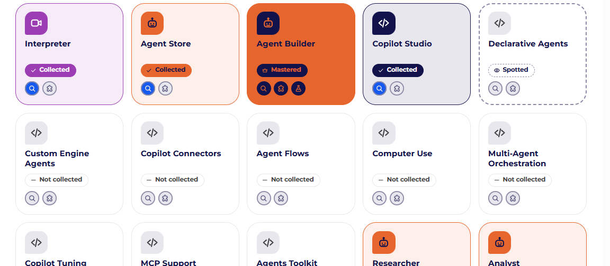
</p>

- The **Feature Tracker** at the top has **Features by difficulty** (a bar each for Easy, Medium, Hard and Expert, with nothing locked) and **Features by category** (a tile and a bar for each category). Every bar shows two things in that difficulty's or category's colour, on a grey track: the features you have **collected** (at least one puzzle done) as **diagonal stripes**, and the features you have **mastered** (every puzzle done) as a **solid fill** at the start of the stripes. A mastered feature is also a collected one, so the solid part sits inside the striped part rather than being added to it. The numbers beside each bar say the same in words (*8/12 collected · 1 mastered*), a screen reader hears the whole sentence, and there is no key to decode. In High contrast mode the stripes are black on white and the solid fill is black. **Tap a category** and it opens underneath: a ring of its puzzles done, a bar for each game mode (*Know it*, *Use it* and *Prompt it*) and every feature in it with its three pies, their counts and its state. The pies **line up in every row**, whatever the feature's state (the state column is a fixed width), and a feature with no Prompt Lab prompts shows a dash in its place. Tap a feature to open it, and tap the tile again (or **Close**) to put the category away.

<p align="center">
  
</p>

- Tap any card for the **popup**, which has everything about the feature, collected or not: its difficulty, category, state and when it was introduced, then the same three **trackers** and three sections that Copilot Learning Mode shows. **Know it** is *What it does* and *Why it matters* (from Feature Hunt). **Use it** is all of its **example scenarios**, each with a title and how Copilot helps (the first-person need is left for Scenario Match itself). **Prompt it** is **one list of prompts**, every one of them shown (nothing is locked or left to discover), each with a **Copy prompt** button at its top right and no ingredient tags: the feature's starter prompt first (*Try this prompt*), then the best prompt from each of its Prompt Lab scenarios, under the line *Copy a prompt and try it in Copilot with your own details.*

<p align="center">
  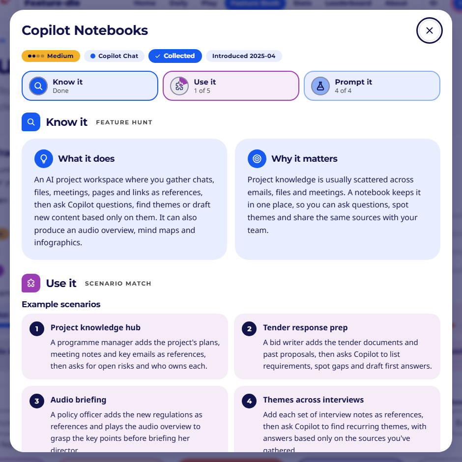
</p>

**Stats**: a header with your name, rank and XP, then four key numbers (**Puzzles played**, **Daily streak**, **Best daily streak** and **Features mastered**), the **Daily Challenge calendar** with **The road to Copilot Champion** beside it, a card for **each game mode** (Feature Hunt, Scenario Match and Prompt Lab: how many you have played, and how many of its puzzles you have done, as *Features known N of 98*, *Scenarios matched N of 343* and *Prompts found N of 39*) and your **achievement badges**. There are no percentages or buttons on the page. The old *Across everything* box, the count of what needs another look (that is now the [Needs Another Look](#needs-another-look) row in Packs), the hints chart, *Collection progress* (it moved into the Feature Book's Feature Tracker) and *Recent games* are gone.

<p align="center">
  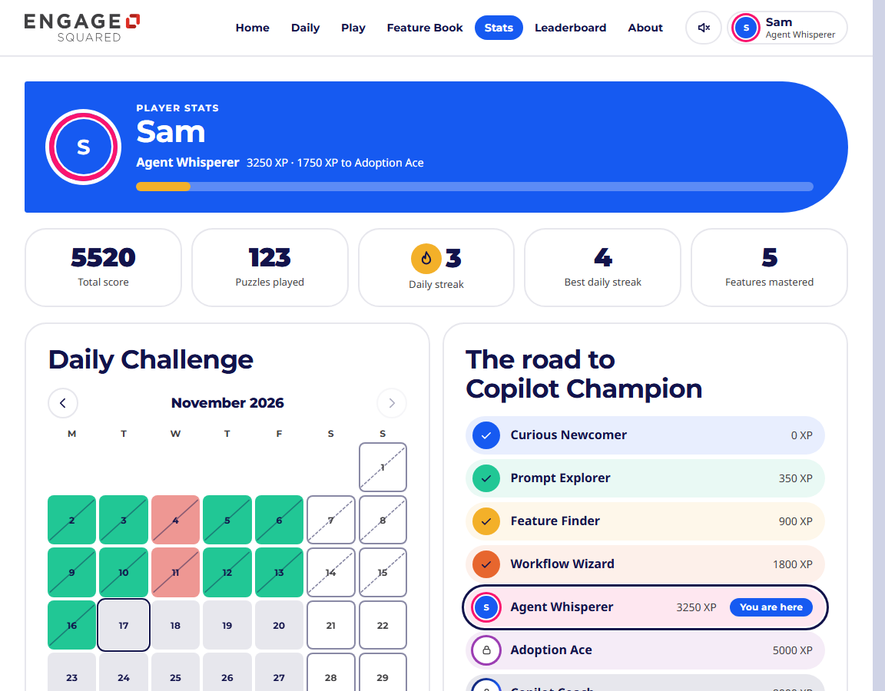
</p>

<p align="center">
  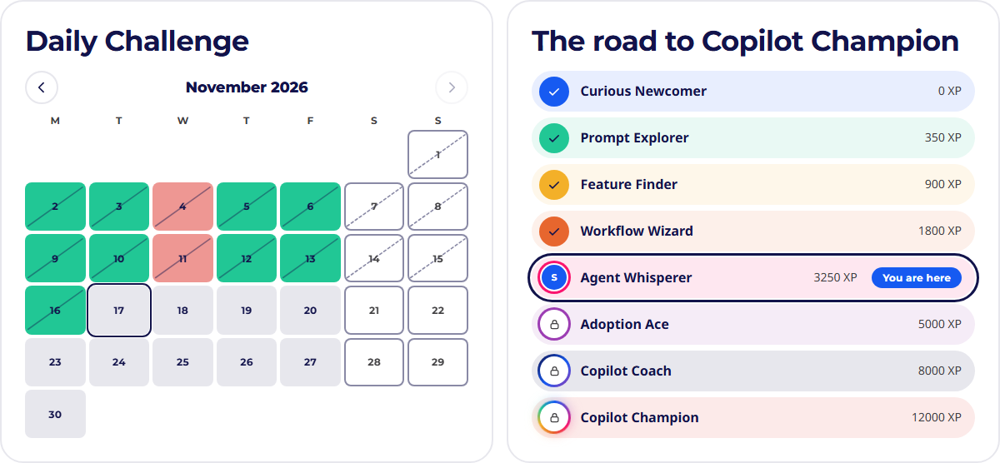
</p>

- The **Daily streak** box is white like the others, and its flame **heats up** with your streak: grey with no streak, yellow from day 1 ("warming up"), orange from **7 days** ("hot") and glowing red from **14 days** ("blazing"). The stages are `streakHeat` in `js/05-config.js`, and a screen reader hears the stage too.
- The **calendar** shows one month at a time, Monday first, with arrows to move between months. It starts on the month the Daily Challenge began, and never opens a month that hasn't started yet. Its days are wide rather than square, so it sits level with **The road to Copilot Champion** beside it (two boxes of the same width and height, in every month). **Green** is solved (even on the last hint or pick), **light red** is not solved (that ends the streak), **light grey** is not played or still to come, and a **dashed outline** is a weekend. Every day that has passed has a **diagonal line** through it, drawn in that day's style (solid on a weekday, dashed on a weekend), and every day is also described in words for screen readers and as a tooltip.
- The **game mode** cards count what you have *done*: **Features known** is the Feature Hunts you have solved, **Scenarios matched** the Scenario Match scenarios you have got right and **Prompts found** the Prompt Lab prompts you have found. **Features mastered** is the number of features with every puzzle done.
- The **achievement badges** have a switch for **All**, **Earned** or **Not earned yet**, each with its count. It says what it is showing, and starts on All every time you open Stats.

**Leaderboard and profiles**: rank by Today, Longest streak, Highest scores (every point from all three game modes), **Most puzzles** and **Mastery** (most features mastered: every puzzle a feature has done). Tap or search a name to open that player's profile: puzzles played, features mastered, longest Daily streak, collection progress, rank and XP to the next rank.

**Platform**: responsive (the main menu stays along the top down to about 920px wide, then moves to a bar along the bottom, and the top bar stays pinned on phones; every screen, the home page's "Your journey" cards, Stats, Settings and the Leaderboard included, stays inside the screen down to 320px wide, at every Text size), keyboard navigable, WCAG 2.2 AA tested, reduced-motion and high-contrast modes, larger-text option, local storage with an in-memory fallback, installable PWA with offline play, a **welcome** from Pip the first time someone opens the game (click Pip on the home page to hear it again), and a **What's new** popup for each update.

---

## The library at a glance

**98 features**, each with five hints, a plain-English explanation, why it matters, an example prompt and a Microsoft documentation link (every link was checked on 23 Oct 2026), plus **343 Scenario Match scenarios** (3 to 8 for every feature: they are its example scenarios) and **39 Prompt Lab scenarios** (29 features have at least one).

| Difficulty | Easy | Medium | Hard | Expert |
|---|---|---|---|---|
| Features | 12 | 27 | 38 | 21 |

| Category | Features | Category | Features |
|---|---|---|---|
| Copilot Chat | 10 | Studio & Extensibility | 17 |
| Microsoft 365 Apps | 16 | Security & Admin | 17 |
| Teams & Meetings | 12 | Adoption & Learning | 8 |
| Agents | 8 | Devices & Mobile | 10 |

Packs: **Copilot Essentials** 12 · **Core** 98 · **Wave 2** 12 · **Wave 3** 6 · **Build Special Edition** 20. Twelve monthly spotlights (3 to 28 features each) pick features by tag.

---

## Scoring in one glance

| Hints used | 1 | 2 | 3 | 4 | 5 |
|---|---|---|---|---|---|
| Points | 100 | 80 | 60 | 40 | 20 |

- **Speed Bonus** (**Daily Challenge only**, in any game mode): +30 (≤15 s), +25 (≤30 s), +20 (≤45 s), +15 (≤60 s), +10 (≤90 s) or +5 (≤120 s) of time spent playing. Every other way to play (Feature Hunt, Free Play, Packs) scores the hint or the pick alone, with no Speed Bonus line anywhere. Only the Daily Challenge shows a stopwatch chip on a Feature Hunt (and says how long you took in its answer), and its clock keeps running if you leave the game; every other game keeps time quietly and pauses it when you leave. The top band (under 15 seconds) is also what the **Perfect Score** badge asks for.
- **No score multiplier.** Points are never multiplied, so everyone plays on the same scale.
- **XP** = score + difficulty bonus (0/10/25/50) + 15 for a new feature + 25 for the Daily Challenge; a Feature Hunt that isn't solved (or a Daily Challenge you miss) still earns 5 XP, while a missed Scenario Match or Prompt Lab question earns nothing. A live **Daily streak** adds **+1% XP per streak day (up to +50%)** to every correct answer.
- **Ranks** (XP needed): Curious Newcomer 0 → Prompt Explorer 350 → Feature Finder 900 → Workflow Wizard 1,800 → Agent Whisperer 3,100 → Adoption Ace 5,000 → Copilot Coach 8,000 → **Copilot Champion** 12,000. The last two steps are the longest (3,000 XP to Copilot Coach, then 4,000 to Copilot Champion).
- **Scenario Match and Prompt Lab points** (the same everywhere they are played: their own games, Free Play and Packs): the best answer on your **1st pick scores 50**, on your **2nd 30** and on your **3rd 10** (`promptLab.points` and `scenarioMatch.points`). There are **three picks and no more** (`maxTries: 3`): if all three are weaker it is a **miss**, worth no points and no XP, with the answer shown and the question added to [Needs Another Look](#needs-another-look). Every point is XP, one for one, and a **perfect game** of Scenario Match or Prompt Lab (3 or more rounds, every pick right first time) adds 3 XP a round (a Free Play or Feature Hunt game has no perfect-game bonus). A Scenario Match or Prompt Lab Daily Challenge uses the same pick points (the score table says *Pick N of 3*) and adds the Speed Bonus on top; three weaker picks lose the day, which ends the streak and earns 5 XP, like a Feature Hunt that isn't solved.
- **Every level is open.** Easy, Medium, Hard and Expert can all be chosen from the start, in every game mode; nothing has to be collected first.
- **Free Play and Feature Hunt games** (see [Rounds in Free Play and Feature Hunt](#rounds-in-free-play-and-feature-hunt)): each round scores and earns XP exactly as it would on its own (a Feature Hunt by its hints, plus its XP bonuses; a question 50, 30 or 10, one XP a point, and nothing for a miss), and is banked the moment it is answered. The results add up the points and XP, and the game's points become your **best game** when they beat it.

All numbers live in `js/05-config.js`: `points` (the hint points above), `speedBonus` (the bands above, Daily Challenge only), `featureHunt.rounds` and `freePlay.rounds` (`min` 1, `max` 10 and `defaultRounds` 5 for a game of rounds), `roundGameMin` (3: how many rounds a game needs to count towards **Round Regular**) and, for Scenario Match and Prompt Lab, `promptLab` and `scenarioMatch` (`rounds`, `points`, `maxTries`, `perfectMinRounds` and `perfectBonusPerRound`).

---

## How the Daily Challenge works

- **Weekdays only.** There is no puzzle on Saturdays and Sundays (the app shows a friendly break screen instead).
- **Numbered by weekday.** The number only moves on a weekday, so Friday #29 is followed by Monday #30 and a weekend has no number. `dailyNumber` in `js/05-config.js` anchors the count (Monday 16 November 2026 is #23, carrying on from the numbers players had already seen).
- **Weekend streaks.** Saturday and Sunday neither extend nor break a Daily streak. The Daily tile says so on Fridays and weekends (for players who have a streak). An old streak that ended on a weekend is treated as ending on the Friday before it, so existing streaks carry over unchanged.
- **A mix of game modes.** Any weekday can be a Feature Hunt, a Scenario Match question or a Prompt Lab question. From `dailyKindsFrom` (17 November 2026) every group of three weekdays holds exactly one of each, in a seeded random order, so the mix is balanced and the same mode never comes up three times running. Days before that were all Feature Hunt, as they always were. A Scenario Match or Prompt Lab Daily keeps your Daily streak and earns the same Daily bonus XP as a hunt. It has three picks, worth 50, 30 and 10 points (the score table says *Pick N of 3*), plus the Speed Bonus on top, and three weaker picks lose the day: the streak ends, the answer is shown and the question goes to Needs Another Look.
- **Random but balanced difficulty.** Every block of 20 weekdays holds exactly 5 Easy, 5 Medium, 5 Hard and 5 Expert days, in a seeded shuffled order, for every game mode. Nothing gets harder as the week goes on.
- **Rotation.** Any weekday that isn't planned by hand (see [Planning the Daily Challenge](#planning-the-daily-challenge)) uses the random rotation. Each difficulty cycles through its own shuffled list, so nothing repeats until that list is used up: a Feature Hunt day draws on the 66 features that aren't marked `"daily": false`, and a Scenario Match or Prompt Lab day on those features' scenarios, at the day's planned difficulty (and the nearest difficulty that has any, so a difficulty with no questions never leaves a gap). Add more features or scenarios to stretch that out.
- **Planned days.** `data/daily.json` can name the puzzle for any weekday (launches, events, themed weeks), including which game mode it is and which scenario to ask. Days it doesn't cover, and every day after its last entry, use the rotation.
- **Ends at midnight.** The challenge ends at the player's local midnight, however much time is left. Its clock is real elapsed time and keeps running if the player leaves. A challenge still open at midnight is recorded as missed (the answer is shown so they still learn it).
- **Streak XP.** There is no streak score bonus. The Daily streak earns bonus XP instead (see [Scoring](#scoring-in-one-glance)).

## Planning the Daily Challenge

By default every weekday's puzzle comes from the random rotation above. To choose a day's puzzle yourself, add it to **`data/daily.json`** (one file, like `features.json` and `changelog.json`):

```json
{
  "days": [
    { "date": "2026-11-16", "feature": "planner-agent" },
    { "date": "2026-11-17", "type": "match", "feature": "copilot-in-teams-meetings", "scenario": "tmeet-late-join" },
    { "date": "2026-11-18", "type": "prompt", "feature": "Copilot in OneNote", "note": "optional reminder, just for you" }
  ]
}
```

- **One line per weekday, in any order.** `date` is `YYYY-MM-DD` (each player's own calendar day). `type` is the game mode: `hunt` (a Feature Hunt, the default when it is left out), `match` (a Scenario Match question) or `prompt` (a Prompt Lab question). `feature` is a feature's `id` from `features.json` or its exact name (capitals, spaces and dashes don't matter). For a `match` or `prompt` day, `scenario` is the id of the question to ask (from `data/scenarios.json` or `data/prompts.json`); leave it out and the feature's first question of that kind is used (then the feature must have one), or give only the `scenario` and the feature comes from it. `note` is optional and only for you. The file opens with a short `help` note for whoever edits it next.
- **Anything you haven't planned uses the random rotation.** A weekday that isn't listed, a gap in the file and every day after the last entry all fall back to the rotation (with the same balanced difficulty mix), so the plan can be half-filled or run out and the game simply carries on. Add more dates whenever you like.
- **Planning a day never moves any other day.** The rotation doesn't read the file, so adding, changing or removing an entry only changes that date. The one way a feature can show up twice close together is if the rotation happens to pick something you also planned on another date.
- **Slips never break the game.** Weekend dates are ignored, a badly written date, a `type` that isn't one of the three, a feature that doesn't exist, a scenario that doesn't exist or is about another feature, or a feature with no questions of that kind is skipped (that day uses the rotation), and when a date is listed twice the first one wins.
- **The build checks it for you.** `tools\build.ps1` reports bad JSON (such as a missing comma), weekend dates, bad dates, unknown types, features and scenarios (features with a "did you mean"), repeated dates and a feature planned twice in the same game mode within 14 days. It then lists the next few planned days with their game mode, how many of each game mode are planned, and shows **how many weekdays ahead the plan reaches**, warning when fewer than 10 are left. It also writes `data/daily.js`, the copy used when the game is opened straight from a folder, and `-Single` builds the plan into the single-file edition.
- **Leave today and past days alone.** Someone part-way through today's challenge would be moved to the new puzzle.
- **What it starts with.** The launch day (23 Oct 2026, Copilot Pages, marked `"daily": false` so the rotation never repeats it) and every weekday from 16 Nov 2026 to 8 Jan 2027: Monday 16 November is still the Planner Agent Feature Hunt, and from Tuesday 17 November each group of three weekdays has one Feature Hunt, one Scenario Match and one Prompt Lab day (the Scenario Match and Prompt Lab days name their scenario).

## Timers

The **Daily Challenge** clock is real elapsed time: it keeps running if you go to another screen, switch tabs or close the app, and the challenge still ends at your local midnight. A pause saved by an earlier version is ignored.

**Every other game** keeps time quietly, with no chip on screen: its clock only runs while the game is on screen. Leaving it (going to another screen, switching to another tab or window, or closing the app) pauses the clock and saves the game, and the time away is never counted. Coming back carries on from the same second. Only the Daily Challenge has a Speed Bonus, so for every other game the time is just for your stats and the **Quick Draw** badge (a Feature Hunt solved in under 20 seconds, in any mode). There is **no countdown timer and no timed round** any more. In the code, a paused game stores `pausedAt` and `activeMs` (`js/70-game.js`), `FD.play.track()` in `js/92-play.js` is how a game's clock hears that the page was hidden, the stopwatch chip (`#play-timer`) is only drawn when `FD.scoring.speedApplies(mode)` is true (the Daily Challenge), and the Daily Challenge opts out of pausing with `realtime: true`.

| Mode | When you leave | When you come back |
|---|---|---|
| **Daily Challenge** | Nothing pauses: the clock is real elapsed time, and the game is saved as you go. The stopwatch chip and the home tile show the clock ticking. | The time away has been counted. The challenge still ends at your local midnight: if the day ended while you were away, it is recorded as missed and the answer is shown. |
| **Feature Hunt and Free Play** (one round or several) | The game is saved, including a hunt or a question you had half-answered, and the clock of the puzzle you were on pauses (a game left for two weeks is let go). | You are offered **Resume game** or **Start a new game**. A round you had already answered moves on to the next round (or the results). |
| **Packs** | The puzzle you were on is saved exactly as it was (a Feature Hunt game with its clock paused, or a question with any weaker picks marked). | **Resume progress** puts you back on that same puzzle. **Start again** resets the pack. |
| **Scenario Match and Prompt Lab** | There is no clock. The game is saved after every pick, and every round you have answered is already banked as XP. | **Resume game** (or **Start a new game**) puts you back on the same round, with any weaker picks you had already tried still marked. |

## Rounds in Free Play and Feature Hunt

**Free Play** and **Feature Hunt** are both played in **rounds**, like Scenario Match and Prompt Lab. The setup screen has a **Rounds** slider from **1 round** to **10 rounds** (5 to start with, and it remembers your last choice). The slider also stops at the number of puzzles your choices leave (*16 features match right now.*), but it keeps the number you asked for, so widening your choices gives it back. Free Play deals one puzzle a round from the game modes you ticked; Feature Hunt deals hunts only. A puzzle is never dealt twice in the same game, and **Prioritise** (on to start with) deals what you haven't tried or solved yet first.

<p align="center">
  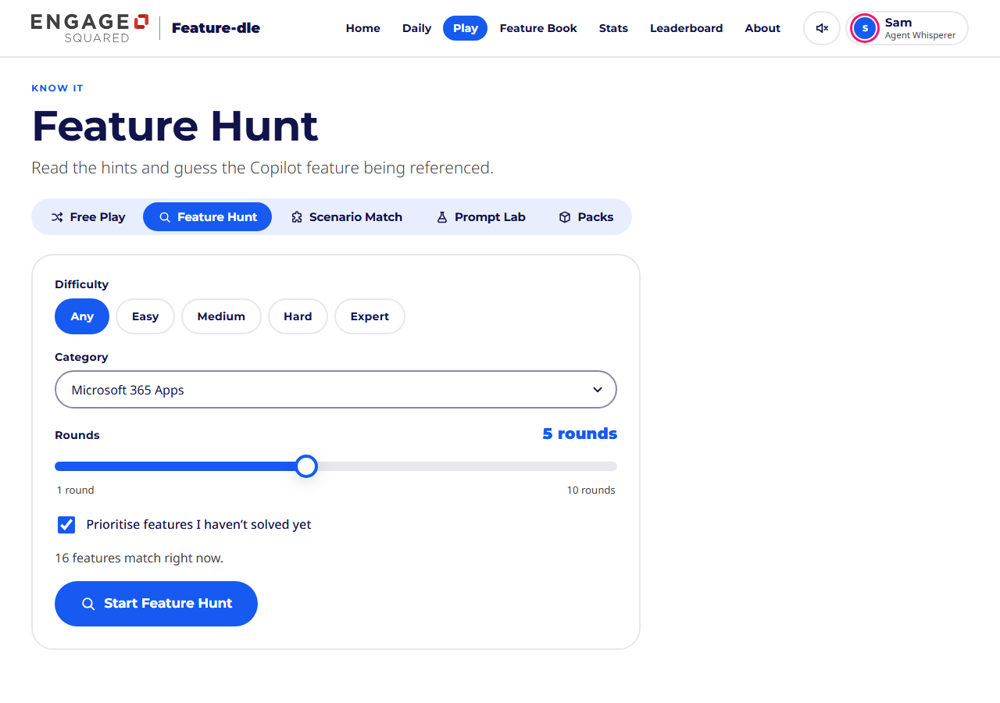
</p>

- **One round** is a single puzzle, just as it sounds: no meter and no round number. A hunt ends with the full answer and Copilot Learning Mode, with **Play again**, **Change settings** and **Feature Book**; a question ends with **Play again** and **Change settings**. There is no results page, and once it is answered there is nothing to resume.
- **Two or more rounds** show the round in the heading (*Free Play · Scenario Match · Round 2 of 5*, naming the game mode of the puzzle in Free Play, or *Feature Hunt · Round 2 of 5*) and a **round meter** under it: a dot for each round (the current one, then each answered round marked by how well it went, or as a miss) and the points so far. When a round is answered, a **Next round** button sits at the top of the answer (**See my results** on the last round): a hunt still shows its full answer, hints and guesses and Copilot Learning Mode (whose buttons repeat **Next round**), and a question shows the usual explanation with its Copy and About buttons.
- **Scoring is the same as everywhere else.** A Feature Hunt round scores by its hints (100 down to 20) and earns its usual XP (5 XP if it isn't solved); a Scenario Match or Prompt Lab round has three picks for 50, 30 or 10 points, one XP a point, and a miss is worth nothing. There is no Speed Bonus. Every puzzle is **recorded the moment it is answered**: its XP is banked, it counts in your Stats and the Feature Book, and a miss goes to [Needs Another Look](#needs-another-look). A question round doesn't show its XP during the game (the results do); a hunt shows its XP like every hunt.
- **The rank-up popup waits** until the results (or until you leave the game), so it never interrupts a round. Badge toasts still show straight away.
- **The results page** comes after the last round: *Clean sweep!* (every round solved), *Nicely done!* (60% or more) or *Good effort!*, with *Free Play complete · 5 rounds* (or *Feature Hunt complete*) above it and how many you solved (and that the ones you missed are waiting in Needs Another Look). Then the **points**, **solved**, **XP earned** and your **best game** (marked *new!* when you beat it), your rank and how far to the next one, how many you solved in each game mode (a Free Play game that solved more than one kind), and **Puzzles you played**: a card for every puzzle with its feature, its game mode and *Solved +N* or *Missed*; tap one to open the feature in the Feature Book. **Play again** starts a new game with the same settings, **Change settings** goes back to the setup screen, and **Your Stats** is beside them.
- **Saved as it goes.** The game is saved after every guess or pick, and when you leave or hide the page, so it waits on its own screen as *You have a Free Play game in progress* (or *Feature Hunt*), with where you are (*Round 3 of 5 · 2 puzzles solved · 150 points so far*) and **Resume game** or **Start a new game**. Resume carries on exactly where you were; a round you had answered but not moved on from goes straight to the next round (or the results). Starting a new game while one is waiting asks first (*Start a new game?*; the rounds you have already answered keep their XP). A game left alone for **14 days** is let go. `#/free?start=1` and `#/hunt?start=1` start a game straight away with your remembered choices.
- **Badges**: **Five Alive** (solve 5 puzzles in one game), **Round Regular** (finish 5 games of 3 or more rounds, `roundGameMin`) and **Clean Sweep** (solve all 10 in a 10-round game).
- **In the code**: the engine is `FD.rounds` in `js/94-view-rounds.js` and the setup screens are in `js/94-view-modes.js`. A game in progress is stored under the active keys **`rounds:free`** and **`rounds:hunt`** (the rounds so far, the puzzle on screen and the filters it was dealt from), and a finished game of two or more rounds goes through `FD.store.recordRoundsGame()`, which keeps `profile.roundsBest` (the best game's points) and the counters `roundBestSolved` and `roundGames`. The remembered choices are `meta.free` (`kinds`, `difficulty`, `category`, `prioritise`, `rounds`) and `meta.hunt` (the same without `kinds`). The numbers are `featureHunt.rounds`, `freePlay.rounds` and `roundGameMin` in `js/05-config.js`.

<p align="center">
  
</p>

---

## Scenario Match

Scenario Match is the **Use it** layer. It teaches **when to use** each Copilot feature, the half of knowing a feature that Feature Hunt (**Know it**) can't. Each question is a real work moment, said the way a person would say it (*"I want to search the web and multiple internal documents at the same time."*), with **four Copilot features**: pick the one that fits best.

<p align="center">
  
</p>

- **A game** is as many **rounds** as you choose, from **1 to 10** (5 to start with, and it remembers your last choice; `scenarioMatch.rounds` in `js/05-config.js`). Play everything, or narrow it with the **Difficulty** pills (Any, Easy, Medium, Hard, Expert: every level is open) and a **Category** dropdown. It is a **multi-select**: tick one category, several, or leave it on *All categories*. A line says how many scenarios match (*343 scenarios match right now.*) and the rounds slider stops at that number. *Prioritise scenarios I haven't met yet* (on to start with) chooses what you haven't met first, then what you have met least and longest ago, with never two scenarios about the same feature in one game. It remembers your last choices too.
- **Points are the same as Prompt Lab**: you get **three picks**, and the best answer on your first pick scores **50**, on your second **30** and on your third **10** (`scenarioMatch.points`; `scenarioMatch.maxTries` is 3). Every point is XP, banked the moment a round is answered (the results at the end show it), and a **perfect game** (3 or more rounds, every pick right first time) adds 3 XP a round. A rank-up popup waits until the game is over.
- **A miss**: if all three picks are weaker, the round is a **miss** for **0 points**. It says *Not this time. The best fit was …*, shows the answer and how Copilot helps, and adds the scenario to **Needs Another Look** so you can play it again from Packs. The game moves on, and the results call it *Missed*.
- **A weaker pick** says **Not quite** and explains what that feature is *really for* (a sentence from its description, or the `why` you write for that option), with an **About** link that opens it in the Feature Book, and lets you try again for fewer points. **The best fit** says how Copilot helps, and links to **Practice prompting it** in Prompt Lab when the feature has prompts. The question never names the answer: the scenario box is purple and the four features are shown with the same coloured icon they have in the Feature Book.
- **The results** show the points, first-pick matches, XP and best game, then the feature that fitted each scenario and how it helps, each with an **About** link.
- **Resume**: the game is saved after every pick (**Resume game** or **Start a new game** on the Scenario Match screen).
- **Badges**: **Scenario Starter** (finish a game), **Good Instincts** (10 first-pick matches), **Scenario Sage** (50) and **Perfect Match** (a perfect game).
- **Everywhere else**: Free Play (as one round of a Free Play game), Packs and the Daily Challenge can all ask a Scenario Match question, and every scenario is also one of its feature's **example scenarios** in the Feature Book. Matching one is a puzzle done, so it **collects** the feature (and helps to **master** it).

### Adding scenarios

The scenarios live in one file, **`data/scenarios.json`**, next to the library. There are **343** to start with, **3 to 8 for every one of the 98 features**. Add an object to `scenarios`, then run `tools\build.ps1`:

```json
{
  "id": "chat-web-and-work-files",
  "feature": "copilot-chat",
  "title": "Web and work files together",
  "need": "I want to search the web and multiple internal documents at the same time.",
  "text": "Copilot Chat can draw on the web and, through Work IQ, the work files you can access, so one question gets a single combined answer instead of two separate searches.",
  "options": ["copilot-in-onedrive", "copilot-in-sharepoint", "copilot-pages"]
}
```

- **`id`** is 3 to 60 lowercase letters, numbers or dashes and must be unique across `scenarios.json` **and** `prompts.json` (a pack or the Daily plan can name a scenario from either). **`feature`** is the feature that is the right answer.
- **`need`** is the question: first person, about 220 characters at most, and it must **not name the feature** (the build warns when it does). **`title`** is the short name shown in the Feature Book. **`text`** is how Copilot helps, shown after the answer and in the Feature Book (it is a good, concrete example, about 280 characters at most).
- **`options`** lists **three other features** that look plausible but are worse fits (never the answer itself). Use `{ "feature": "copilot-pages", "why": "..." }` instead of a plain id to say why that one isn't right; otherwise the explanation is what that feature is for.
- **Three or more scenarios for a feature** gives it a proper set of example scenarios. Keep them honest: check each need against current Microsoft documentation, and avoid scenarios two features could both answer.
- **The build checks it for you** (`tools\build.ps1`): bad JSON, duplicate ids (also against Prompt Lab's), a feature that doesn't exist (with "did you mean"), fewer than three different wrong features, an option that is the answer itself, over-long text, a need that isn't in the first person or that names its answer, and a feature with fewer than three scenarios. Anything it can't use is also left out when the game loads and listed in the browser console, so a slip never breaks the game. It then writes `data/scenarios.js` for the single-file edition and `file://`.
- The first scenario of a feature is the one its packs ask, so make that one the clearest.

## Prompt Lab

Prompt Lab is the **Prompt it** layer. It teaches **how to prompt** a feature, the skill behind all the others: **writing a good prompt**. It follows Microsoft's own guidance on Copilot prompts, which says a prompt can have four parts, and that only a clear goal is essential:

| Ingredient | What it means |
|---|---|
| **Goal** | What you want Copilot to do. |
| **Context** | Why you need it, and who it is for. |
| **Source** | The files, meetings, emails or sites Copilot should use. |
| **Expectations** | The format, length and tone you want back. |

On the setup screen, the **What makes a good prompt?** link opens a short guide to the four ingredients: what each one means, an example of each, and all four together in a single prompt, with a link to Microsoft's guide to writing prompts.

<p align="center">
  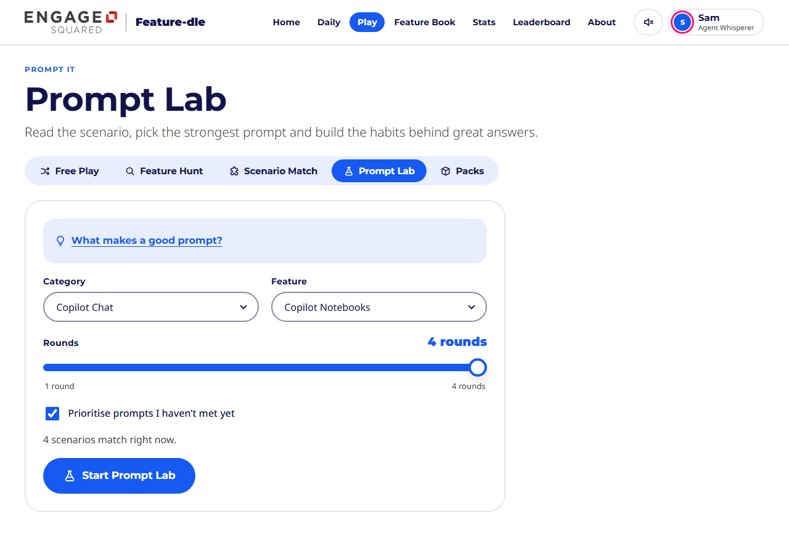
</p>

<p align="center">
  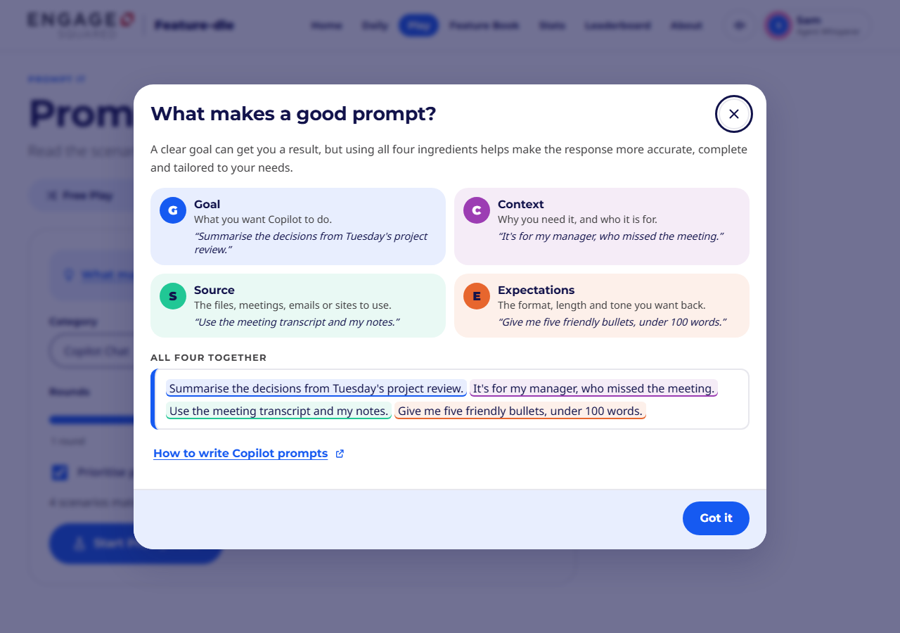
</p>

<p align="center">
  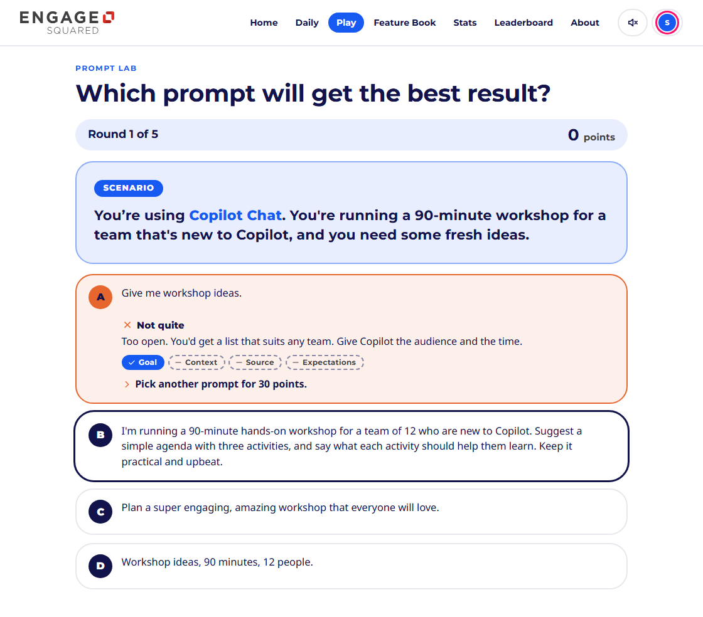
</p>

**A game** is as many **rounds** as you choose, from **1 to 10**: a slider on the setup screen (5 to start with, and it remembers your last choice; `promptLab.rounds` in `js/05-config.js`). Above it sit a **Category** dropdown and a **Feature** dropdown, side by side. Both are **multi-selects** (a button that opens a list of tick boxes, the same as in Feature Hunt and Free Play), so you can play **everything**, **one category** (say *Copilot Chat*), **several categories**, or **just one feature in them** (say *Copilot Notebooks*, to practise only its scenarios):

- Only categories and features that have **at least one scenario** are listed, in the Feature Book's order. The **Feature** dropdown waits (switched off, saying *Choose a category first*) until a category is ticked, then lists the features in the ticked categories, under a heading for each category when you have ticked more than one. A feature you have ticked stays ticked while its category does.
- A line says how many scenarios match (*4 scenarios match right now.*), and the rounds slider **stops at that number**: a feature with 4 scenarios is up to 4 rounds, and one with a single scenario is one round. The slider still remembers the number you asked for, so going back to *All categories* gives you your 5 rounds again.
- **Prioritise prompts I haven't met yet** (on to start with) chooses the prompts you haven't met first, then the ones you have met least and longest ago. Turn it off and the game is a random pick from whatever matches.
- Your categories, features, number of rounds and prioritise choice are remembered on this device. The round heading, **Resume game** and the results name what the game is about (*Prompt Lab · Copilot Notebooks · Round 1 of 4*, or a count such as *3 categories* when you have ticked more than two), and **Play again** keeps the same choices.

Each round asks **Which prompt will get the best result?** over a blue box labelled **Scenario**: a short workplace scenario ("You missed Tuesday's project review, and your manager wants the decisions by lunchtime.") with **four prompts**, one of them clearly the best. The box names the **full Copilot feature** it is about ("Copilot in Word", not just "Word"), with the same coloured icon that feature has in the Feature Book. Pick one:

- **The best one on your first pick scores 50**, on your second 30 and on your third 10 (`promptLab.points`). You get **three picks** (`promptLab.maxTries`). A weaker pick says **Not quite**, explains why in a sentence, shows which of the four ingredients that prompt had and which it was missing (ticks *and* words, never colour alone), and lets you try again for the next score down.
- **A miss**: if all three picks are weaker, the round is a **miss** for **0 points** (and no XP). It says *Not this time. The best prompt is marked above.* and shows the best one, and the scenario goes to [Needs Another Look](#needs-another-look) so you can play it again from Packs. The game carries on, and the results mark that round *Missed*.
- When the best prompt is found (or after a miss), **all four prompts are explained**, with a one-line takeaway, a **Copy the best prompt** button (copying counts towards the *Prompt Pilot* badge) and an **About &lt;feature&gt;** button that opens that feature in the Feature Book.
- **Every point is XP**, one for one, like every other mode. It is banked the moment a round is answered, so leaving half-way never loses it, but a round never shows an XP figure: the **results at the end** do. A game of **3 or more rounds** where every pick was right first time is a **perfect game** and adds **3 XP for each round** (`perfectMinRounds`, `perfectBonusPerRound`). If a round takes you up a rank, the rank-up popup waits until the game is over (or until you leave it). Prompt Lab has its own badges: **Prompt Crafter** (10 first-try picks), **Prompt Master** (50), **Prompt Pro** (a perfect game), **Perfect Ten** (a perfect 10-round game) and **Prompt Regular** (5 games).
- **The results** show the points, the first-try picks, the XP (bonus included), your best game and your rank progress, then **The prompts worth keeping**: a box for every round with the feature's name and how that round went (*First try +50*, say) on the left and a **Copy prompt** button in the **top right corner**, then the scenario and the best prompt. The four ingredient chips are left out here (they belong to the answer during the game), so each box is just the prompt to keep. A link to Microsoft's guide to writing prompts follows, then **Play again** (which keeps your number of rounds, categories, features and prioritise choice), **Free Play** and **Your Stats**.
- A game is chosen as the **Prioritise prompts I haven't met yet** tick box says (see above), with **never more than two scenarios from the same app** as far as the matching scenarios allow. The prompts are shown in a shuffled order each time (A, B, C and D), so the best one isn't always in the same place.
- The game is saved after every pick, so leaving never loses it (**Resume game** or **Start a new game** on the Prompt Lab screen). The setup screen is a **What makes a good prompt?** box (the link to the guide above, in the place the difficulty pills have in the other modes, so the Category dropdown sits at the same height in every mode), the Category and Feature dropdowns, the rounds slider and the prioritise tick box, and your **games played and prompts found** are on the **Stats** page.

<p align="center">
  
</p>

### Adding scenarios

The scenarios live in one file, **`data/prompts.json`**, just like the feature library. There are **39** to start with, covering Teams, Outlook, Word, Excel, PowerPoint, Copilot Chat, Researcher, Analyst, Pages, Notebooks, Search, OneNote, Loop, Forms, OneDrive, Agent Builder, Think Deeper, Vision, Edge, the Prompt Gallery, Memory, Facilitator, Create, SharePoint, Teams Phone and Actions. Most features have one or two; **Copilot Notebooks has four**, so choosing it under **Category → Copilot Chat → Feature** is a real game. Add more scenarios for a feature and they appear in the dropdowns, and in the packs that hold the feature, by themselves. Add an object to `scenarios`, then run `tools\build.ps1`:

```json
{
  "id": "missed-meeting-recap",
  "app": "Teams",
  "feature": "teams-meeting-recap",
  "situation": "You missed Tuesday's project review, and your manager wants the decisions by lunchtime.",
  "options": [
    { "text": "Summarise the meeting.", "has": ["goal"], "why": "Copilot can do it, but it doesn't know which meeting, who it's for or what matters." },
    { "text": "Using the transcript and notes from Tuesday's project review, list the decisions made, the follow-up tasks and who owns each one. Keep it to five bullets I can paste into an email to my manager.", "has": ["goal", "context", "source", "expectations"], "best": true, "why": "A clear goal, the exact meeting, the audience and the format." },
    { "text": "Tell me everything that was said in the meeting, in as much detail as possible.", "has": ["goal"], "why": "Asking for everything buries the decisions." },
    { "text": "Hi Copilot! I wasn't at the meeting and I'm in a rush, so could you please help me work out what I missed? Thanks so much!", "has": ["goal", "context"], "why": "Friendly, and it hints at the situation, but it doesn't name the meeting, say who it's for or ask for a format." }
  ],
  "tip": "Name the meeting, say what you need from it, and set the format."
}
```

- **`id`** is 3 to 60 lowercase letters, numbers or dashes and must be unique. **`app`** is the short label on the question. **`feature`** is a feature `id` from `features.json`. It makes the *About &lt;feature&gt;* button and the feature name on the question, and it **files the scenario** under that feature and its category in Prompt Lab's **Category** and **Feature** dropdowns, and in every pack that holds the feature. Give every scenario a feature: one without a feature is only played when Prompt Lab is set to everything.
- **Exactly four prompts, exactly one with `"best": true`.** `has` lists the ingredients a prompt **really** contains (`goal`, `context`, `source`, `expectations`), because the answer screen shows them. The best prompt should have **more** ingredients than the others, so the lesson is clear. A longer prompt isn't automatically better: make the weaker ones vague, unfocused, or missing the source or the format.
- **`why`** is one friendly, specific sentence (about 230 characters at most) that says what is missing or what works, without shaming anyone. **`situation`** is about 200 characters at most and **`text`** about 330. Use Australian English and prompts a real person would type.
- **The build checks it for you** (`tools\build.ps1`): bad JSON, duplicate ids, a feature that doesn't exist (with "did you mean"), the wrong number of prompts, no or two best prompts, an ingredient that isn't one of the four, a best prompt with no more ingredients than the others, and over-long text. Anything it can't use is also left out when the game loads and listed in the browser console, so a slip never breaks Prompt Lab. It then writes `data/prompts.js` for the single-file edition and `file://`. Aim for 30 or more scenarios so rounds don't repeat quickly.
- The four ingredients and the **learn link** (Microsoft Support's *Get started with writing prompts in Microsoft 365 Copilot*) are at the top of the file (`ingredients`, `learnMore`). `tools\check-links.ps1` checks that link too.

## Packs

Every pack and monthly spotlight is made of **Feature Hunt puzzles**, **Scenario Match questions** and **Prompt Lab questions**. By default a pack holds its features (from `packs` and `tags` in `data/features.json`), **one Scenario Match question for each of those features** (its first scenario in `data/scenarios.json`) **and every Prompt Lab scenario about them**, so a new Prompt Lab scenario for Copilot in Excel joins every pack that holds Copilot in Excel, and the count on the pack (*12 Feature Hunt + 12 Scenario Match + 11 Prompt Lab*) follows by itself. The **Copilot Essentials** official pack (`copilot-essentials`) is twelve features you add to by putting its id in a feature's `packs`. To choose a pack's questions yourself, give the pack (in `packs`) or the spotlight (in `themes`) a list of scenario ids, from either file:

```json
{ "id": "wave-3", "name": "Copilot Wave 3", "scenarios": ["deck-from-report", "simplify-a-slide"] }
```

An empty list (`"scenarios": []`) keeps a pack or spotlight to Feature Hunt puzzles only, and a list replaces the defaults above and may name scenarios about features that aren't in the pack. The build prints what every pack and spotlight holds, and stops with an error if a list names a scenario that doesn't exist in either file. In a pack's saved progress a Prompt Lab question is stored as `prompt:<scenario id>`, a Scenario Match question as `match:<scenario id>` and a Feature Hunt puzzle as its plain feature id, so older saves keep working; a pack someone had already finished just has new questions waiting for them.

## Needs Another Look

**Needs Another Look** is a pack made for you, at the top of **Packs** under **Made for you**. It holds **the puzzles you missed**, from **all three game modes**: a Feature Hunt joins the list when your **latest try was a miss** (you ran out of hints, or gave up and revealed it), and a Scenario Match or Prompt Lab question joins it when you **missed all three picks**. **Get it right, in any number of hints or picks, and it comes off the list.** It follows your *latest* try, so a solve followed by a miss puts it back, and getting it right again clears it. A Feature Hunt save from before this was tracked is judged on what the Feature Book already knew (a feature you have seen but never solved).

- **It only shows when there is something on it.** With nothing to revisit there is no row at all, and no **Made for you** heading either, so a new player (or one who is all caught up) just sees the official packs and the monthly spotlights. When it does show, it is a **slim row**: an icon, the name, a line about it (*Puzzles you missed. Get one right and it comes off your list.*) and **Play N**, where N is the number of puzzles waiting. It is in the same family as a monthly spotlight row (the same width and corners, with an icon where the month would be), but shorter, because there is no progress bar.
- **It isn't progress based.** There is no progress bar, and no **Resume progress** or **Start again**. Every time you press Play it starts a **fresh run** of what you have missed right now.
- **A run** plays those puzzles one at a time, each once, with **Next puzzle** after each one (the list is frozen as the run's queue, so a puzzle that clears halfway doesn't change the count). Inside the run a Feature Hunt is played as a hunt and a question as a question, and the run's queue holds one key for each puzzle: a feature's plain `id` for a Feature Hunt, `match:<scenario id>` for a Scenario Match question and `prompt:<scenario id>` for a Prompt Lab question. When the run ends, the screen says **Run complete!**, how many puzzles you played and how many are still on your list, and offers **Play N** for them (or **Back to Packs**). A run is **not** one of the "finish a whole pack" badges, but it has its own: **Back for More** (play through everything on the list), alongside **Second Look** (clear a puzzle) and **Redemption Arc** (clear 10).
- **The answer screen tells you** when a game changes the list: *Added to Needs Another Look*, *Still on your Needs Another Look list* or *Off your Needs Another Look list*, in a Feature Hunt, Scenario Match and Prompt Lab alike. The **Stats** page no longer counts what is waiting: the row in Packs is the place to look.

---

## Adding or editing features

The whole library is one file: **`data/features.json`**. Add an object to `features`, then run the build script.

```json
{
  "id": "copilot-pages",
  "name": "Copilot Pages",
  "aliases": ["Pages", "Copilot Page"],
  "difficulty": "Medium",
  "category": "Copilot Chat",
  "tags": ["collaboration", "creation"],
  "packs": ["core", "wave-2"],
  "introduced": "2024-09",
  "hints": [
    "I collect ideas, but I'm not OneNote.",
    "I help preserve AI-generated work.",
    "Conversations can become collaborative artefacts.",
    "I turn chat responses into something your team can edit.",
    "My name suggests somewhere information can live."
  ],
  "description": "What it does, in 1-2 plain sentences.",
  "why": "Why it matters at work.",
  "prompt": "An authentic prompt someone could paste into Copilot.",
  "learnMore": "https://learn.microsoft.com/…",
  "learnLabel": "Microsoft Learn: Copilot Pages",
  "related": ["copilot-notebooks"]
}
```

| Field | Notes |
|---|---|
| `name`, `hints` | Required. Provide 3-5 hints (5 is ideal; the game pads missing ones with simple clues). Keep the name out of hints 1-3. |
| `difficulty` | `Easy` · `Medium` · `Hard` · `Expert`. Drives the Daily difficulty mix, the Difficulty pills and XP. |
| `category` | Must exist in `categories` (name, colour and icon). A category can also carry an optional one-line `blurb`; the game doesn't currently show it. |
| `tags` | Free-form lowercase words. Used for monthly spotlights and the "warm" clue. |
| `packs` | `core` (the Daily Challenge, Feature Hunt and Free Play draw on it), plus any pack id from `packs`. |
| `daily` | Set to `false` to keep a feature out of the Daily Challenge (it stays in Free Play and Packs). |
| `related` | Ids that players commonly mix it up with (gives a "hot" clue). |
| `aliases` | Other names players might type. Brand prefixes ("Copilot", "Microsoft 365") and plurals are handled automatically. |
| *(example scenarios)* | A feature's **example scenarios** (Learning Mode, the Feature Book) are its Scenario Match scenarios in `data/scenarios.json`, so they are written there (see [Scenario Match](#scenario-match)). An older `useCases` list (a `title` and a `text` each) on a feature is only used when the feature has no scenarios of its own, which keeps community packs working. |

Also in `features.json`: `categories`, `packs` (the boxes in the sideways row under **Packs**), `themes` (monthly spotlights: `month` + `year` + `tag`, shown as rows under **Packs**; give each one a `year`, make every `id` unique across all years, and the **year toggle** appears for every year that has spotlights with features). A pack or a spotlight can also carry a `scenarios` list to choose its own questions (see [Packs](#packs)). The old `schedule` list is no longer read: plan days in `data/daily.json` instead (see [Planning the Daily Challenge](#planning-the-daily-challenge)). Add `"daily": false` to a feature to keep the random rotation from ever choosing it.

**After editing, run:**

```powershell
powershell -ExecutionPolicy Bypass -File tools\build.ps1            # validate, refresh data\features.js, changelog.js, daily.js, prompts.js, scenarios.js and the offline cache list
powershell -ExecutionPolicy Bypass -File tools\build.ps1 -Single    # ...and rebuild Copilot-Feature-dle.html
powershell -ExecutionPolicy Bypass -File tools\check-links.ps1      # confirm every Learn link still opens
powershell -ExecutionPolicy Bypass -File tools\format-json.ps1      # keep features.json tidy (safe: refuses to change any content)
```

The build tool validates the schema (duplicate ids, missing hints, unknown categories, hints that give the name away, alias clashes…), checks the changelog, the Daily plan, the Prompt Lab scenarios and the Scenario Match scenarios, and prints the difficulty and category mix (and, after the Scenario Match check, what every pack and spotlight holds: its Feature Hunt puzzles, Scenario Match questions and Prompt Lab questions). **Always run it before committing**, so `data/features.js`, `data/changelog.js`, `data/daily.js`, `data/prompts.js`, `data/scenarios.js` and the offline cache list stay in step with their JSON.

## The welcome and the "What's new" popup

**Welcome.** The first time someone opens the game, Pip says **Hi, I'm Pip!** with a quick breakdown of what the game is and what you can do (there is no name step: the player is simply "Player" until they [sign in with Microsoft](#microsoft-sign-in), which the welcome offers once sign-in is switched on, with playing as a guest still one click: **Let's play**). It shows once, and a new player has nothing to catch up on in What's new. Clicking **Pip** on the home page opens it again at any time (that doesn't count as having seen What's new, so a returning player still gets their update popup).

**What's new.** Everyone else sees the **What's new** popup **automatically, once, whenever there is an update**: a new `version`, or any change to the game updates or the Microsoft updates in `data/changelog.json` (so adding a Microsoft update shows it to everyone once, even if you forget to change the version). It can be dismissed, and it can be reopened any time from **What's new** in the footer.

Everything it says lives in one place: **`data/changelog.json`**.

```json
{
  "version": "1.5.0",
  "date": "2026-11-17",
  "intro": "Optional one-line introduction.",
  "game":      [ { "title": "What changed in the game", "text": "Optional detail." } ],
  "microsoft": [ { "title": "A Microsoft Copilot update", "text": "What it is.", "date": "2026-11", "link": "https://learn.microsoft.com/…", "linkLabel": "Read the release notes" } ],
  "microsoftEmpty": "Shown instead when the microsoft list is empty",
  "history":   [ { "version": "1.3.0", "date": "2026-11-16", "notes": ["Free Play mixes all three game modes, and Category and Feature became drop-downs that let you tick several."] } ]
}
```

To publish an update: edit the file (add a `game` or `microsoft` item, and bump `version` when it is a new release), keep `version` in `js/05-config.js` the same (the build warns if they differ), then run `tools\build.ps1`. Each person sees it once, automatically. Links must be `https://`.

---

## Leaderboards

1. **On this device (default).** Everyone who has played on this device is ranked (a guest, plus each person who has [signed in with Microsoft](#microsoft-sign-in)), alongside clearly-labelled **sample players** that keep the board lively (turn them off in Settings). A guest is just *Player*, and a signed-in player is their name, like *Alex R.*.
2. **Live event board.** `tools\serve.ps1` also exposes `/api/leaderboard`. Run `tools\serve.ps1 -Lan` as administrator, share `http://<your-ip>:8080/?event=LUNCH26` and everyone who opens the link joins the same Daily board (scores post automatically after each daily game). Data is saved to `tools\leaderboard-data.json` (git-ignored, because it holds player names).
3. **Your own endpoint.** Set `leaderboard: { endpoint, eventCode }` in `js/05-config.js` (an Azure Function, Power Automate HTTP flow, SharePoint list front-end…):
   - `POST {endpoint}` with JSON `{ eventCode, date, playerId, name, color, today:{score,hints,timeMs,won}, maxStreak, totalScore, bestScore, played, xp, collected, mastered, achievements }` → `200`. `played` is every puzzle the player has answered in any game mode, `totalScore` is every point from all three game modes, `collected` is how many features they have collected (any one puzzle done) and `mastered` is how many they have mastered (every puzzle a feature has done: its Feature Hunt, all of its Scenario Match scenarios and all of its Prompt Lab prompts). For a Scenario Match or Prompt Lab Daily Challenge, `today.hints` is the number of picks.
   - `GET {endpoint}?eventCode=…&date=YYYY-MM-DD` → `{ "players": [ { playerId, name, color, today|null, maxStreak, totalScore, bestScore, played, xp, collected, mastered, achievements } ] }`. The extra `xp`, `collected` and `mastered` fields fill in the player profile (rank, XP to the next rank, collection progress and the Mastery ranking); a board that doesn't send them still works, and shows "Not shared" for those items. `bestScore` and `achievements` are still accepted but the profile no longer shows them.

   The client never blocks or fails if the endpoint is down. An event link can only point the board at the **same site** it was opened from.

GitHub Pages is static hosting, so it can't run a live board by itself: on the public link, scores stay on each player's device. Use option 2 or 3 for rooms.

Scores are self-reported by the browser, so treat shared boards as friendly fun, not an audit trail.

---

## Microsoft sign-in

Players can **sign in with their Microsoft account** (work, school or personal, as you choose), and the game uses it in place of the anonymous "Player" profile. It needs **no server**: the game talks to Microsoft directly using the standard *authorization code with PKCE* flow for single-page apps, written out in `js/57-auth.js` (no libraries). It is **off until you connect an app**, and guests can always still play.

**What people get**
- A **Sign in with Microsoft** button in the top bar (for a guest; on a phone it is the Microsoft logo, and also in the **More** menu), in Pip's welcome, and on **Settings → Your account**, **Stats** and the **Leaderboard**.
- A player profile built from their account: their name shown as **"Alex R."** (set `nameStyle: 'full'` for the whole name, kept to 24 characters), and an id (`ms_` plus 24 characters taken from a SHA-256 of their tenant id and object id) that is the same for the same Microsoft account on every device, which is what a future shared leaderboard or server would key on.
- **Their own progress.** Each person who signs in on a device has their own profile, so a shared laptop at a workshop keeps everyone apart. **Sign out** (in Settings) goes back to the guest profile, and the account's progress waits on the device for next time.
- **Nothing is lost when someone signs in for the first time on a device that already holds a guest's progress.** They are asked, and cannot dismiss the question by accident (no close button, **Esc** and clicking outside do nothing): **Add my progress** moves it into their account, or **Start fresh** leaves it with the guest.
- A **backup** file never contains the Microsoft account or email, and **importing** a backup only brings in progress: it can never change who you are signed in as. **Reset my progress** keeps you signed in.
- Progress still lives in the browser on that device. It isn't synced between devices (export and import a backup to move it).

**Switching it on (about five minutes)**
1. In the [Microsoft Entra admin centre](https://entra.microsoft.com), go to **App registrations → New registration** ([how to register an app](https://learn.microsoft.com/en-us/entra/identity-platform/quickstart-register-app)). Name it, for example, *Copilot Feature-dle*, and choose who may sign in: *this organisation only* (use your tenant id as `tenant`), *any organisation* (`tenant: 'organizations'`, the default) or *any organisation and personal Microsoft accounts* (`tenant: 'common'`).
2. Under **Authentication**, add a **Single-page application** redirect URI (not *Web*; the SPA type is what lets the browser redeem the code) with the address of your game **exactly** as the game reports it: open **Settings → Your account → "Setting this up?"** and copy it. For the public game that is `https://liame2.github.io/copilot-feature-dle/` (note the trailing slash); for local testing add `http://localhost:8080/` too. Redirect URIs must be `https` (except `localhost`) and are matched exactly.
3. Copy the app's **Application (client) ID** into `js/05-config.js`, under `auth`, and set `tenant` to match step 1. There is **no client secret**, no certificate and no extra API permission: the game only asks for `openid profile`, so people can normally sign in without an administrator approving anything (if your organisation blocks user consent, an admin can grant it once in the app's *API permissions*).
4. Run `tools\build.ps1` (so the offline cache list refreshes), publish, and open **Settings → Your account**: the **Sign in with Microsoft** button is there.

| `auth` setting in `js/05-config.js` | What it does |
|---|---|
| `clientId` | The app's Application (client) ID. **Empty = sign-in is off** and the game is guest-only, exactly as before. |
| `tenant` | `'organizations'` (work or school accounts, the default), `'common'` (those and personal accounts), `'consumers'` (personal only), or your own tenant id or domain to let only your people in. It must match the account types you chose in step 1. |
| `authority` | Leave empty to use `https://login.microsoftonline.com/<tenant>`. Set it for a national cloud (and add that host to the `connect-src` in `index.html`'s Content Security Policy) or for the test identity provider below. |
| `redirectUri` | Leave empty to use the game's own address. It must be registered on the app. |
| `required` | `true` makes everyone **sign in before they can play**: guests see a friendly "Sign in to play" screen in front of every page. It's a gate for a team site, not security (the game runs in the browser, so anyone could read its code). It only applies when sign-in can actually work, so a copy with no client id never shuts anyone out. |
| `nameStyle` | `'short'` ("Alex R.", friendlier on a big screen) or `'full'`. |

**How it stays safe**
- **PKCE (S256) with a random `state` and `nonce`** for every attempt. The secret verifier lives only in this tab's `sessionStorage` for at most 15 minutes, is used once, and is never written to `localStorage` or put in an address.
- **The code is wiped from the address bar before anything else happens**, only a `#fragment` return is accepted (a `?code=` is ignored), and the player is only ever returned to one of the game's own screens.
- **The ID token's claims are checked** before anyone is signed in: it must be for *this* app (audience), from the expected issuer and organisation, not expired or not yet valid (five minutes of clock drift allowed) and carry the right nonce; the account id must be present. Its **signature is not verified**: it comes straight from Microsoft's token endpoint over TLS, which OpenID Connect allows, and this sign-in only chooses a profile on the player's own device. **If you ever add a server that trusts who someone is, it must validate the token itself.**
- **No token is kept.** After the claims are read, the tokens are thrown away. Only the name, email and tenant id are saved, on the player's own profile.
- **Tight network rules.** The page's Content Security Policy only lets it talk to its own site and `https://login.microsoftonline.com`, and the service worker never touches sign-in traffic.
- **Everything that goes wrong leaves you a guest, with a friendly message**: a cancelled sign-in, a stale or forged return, a token meant for someone else, no network, or an error from Microsoft. Messages from outside are escaped before they are shown.
- The button is Microsoft's own: their logo and wording, in their light colours (`#5E5E5E` text on white with a `#8C8C8C` border), following Microsoft's [sign-in branding guidelines](https://learn.microsoft.com/en-us/entra/identity-platform/howto-add-branding-in-apps). Their full-colour logo is only used on white, never on the blue Stats header.

**Trying it without registering an app.** `tools\serve.ps1 -Port 8080 -MockAuth` adds a pretend Microsoft sign-in at `/mock-idp` (it refuses `-Lan`, signs in three made-up people and checks PKCE like the real thing). Open the game from that server and, in the browser console, run `FD.config.auth.clientId = 'test'; FD.config.auth.authority = location.origin + '/mock-idp/organizations'; FD.ui.renderTools(); FD.ui.render();` to see the button, then sign in, cancel, switch accounts and sign out. Never use it on a real site.

**Limits.** Sign-in needs an `https` address (or `localhost`), so the single-file edition, which never contacts a server, stays guest-only. It's per device (see above), and national clouds need the CSP edit mentioned in the table.

---

## Branding

The look follows the *Engage Squared Brand Guidelines*: Montserrat Bold headings and Noto Sans body (Calibri fallback, fonts self-hosted so offline play looks right), the exact palette (`#DD2E27 #F3B029 #E7662E #9C3DB3 #165AF1 #12134B #FA146E #21C795 #000000 #414042`) and the official 75 / 50 / 10% tints, the pill / arch shapes and white logo "tab" from the collateral, and the `<people> friendly technology` device. The brandmark in `assets/img` is the official artwork extracted from the guidelines PDF; keep its clear space and don't recolour it.

**Text on the home tiles.** There are six tiles in a 3 x 2 grid (two across on a narrow screen, one on a phone), with the three game modes in the top row: Feature Hunt, Scenario Match and Prompt Lab, then Free Play, Packs and Feature Book. Feature Hunt is the brand blue, Scenario Match the brand purple and Packs the brand red, all with white text, and Prompt Lab is the 50% blue tint with navy text. The Free Play tile is the brand orange `#E7662E` and Feature Book the brand green `#21C795`, and both carry dark navy text (`#12134B`), which reaches WCAG AA (4.5:1) on the orange (5.2:1) and the green (7.9:1); white would only reach 3.3:1 on the orange and 2.2:1 on the green. Every tile takes its text colour from the `.c-*` roles in `css/base.css` (white on red, purple, blue and navy; navy on orange, yellow, green and the 50% blue tint), so no tile needs an override in High contrast mode. The deeper green `#157F5F` (`--green-deep`) is only the tick colour in Pip's extras. **Hover:** a tile only lifts 4px when you hover over it. Don't add a tilt, scaling or a hover shadow in `css/views.css`: each of them makes the text on the tile look blurry (tilting redraws it at an angle, and a shadow makes the browser swap crisp ClearType text for softer grey smoothing). A test guards this.

Pip, the game's bracket-eared guide, and the "Feature-dle" wordmark are original artwork for this game.

---

## Accessibility

Skip link, landmarks, ARIA 1.2 combobox with live announcements, focus rings that work on every background, 44 px touch targets, no colour-only meaning (icons + text for hot/cold, easier/harder, Pip's extras and the Feature Book's four states, where every card has an icon and a word for *Not collected*, *Spotted*, *Collected* or *Mastered*; the Feature Tracker's stripes and solid fills always come with the numbers beside the bar, and a screen reader hears them as a sentence; weekend days are dashed as well as grey), reduced motion (device setting or override, which also switches off smooth scrolling), high contrast mode and text size options. The definition popovers on the **Same category** / **Same level** chips of a guess open on hover, keyboard focus or tap, can be hovered, and close with **Esc** (WCAG 1.4.13). The **Category** and **Feature** dropdowns that let you pick several (in Feature Hunt, Free Play, Scenario Match and Prompt Lab) are a **button that discloses a group of real checkboxes**, rather than a custom listbox: the label belongs to the button, which says what is ticked (*All categories*, one or two names, or a count) and carries `aria-expanded` and `aria-controls`, and the list is a labelled group with *All categories* first (nothing ticked means all). **Enter**, **Space** or the **Down** and **Up** arrows open it and move focus into the list, **Up**, **Down**, **Home** and **End** move between the boxes, **Space** ticks one, **Esc** closes it and puts focus back on the button, and moving focus away (or clicking elsewhere) closes it. A dropdown that is switched off (Prompt Lab's **Feature**, until a category is ticked) is a disabled button with its reason written beside the label. The three pie icons on a Feature Book card are described in words for screen readers (*Know it: Done. Use it: 2 of 5. Prompt it: No prompts yet.*). The pinned top and bottom bars on phones never hide a focused control. The clocks only run while you are playing (except the Daily Challenge, which is real elapsed time), and nothing is ever against the clock apart from the Daily Challenge's Speed Bonus (a bonus, never a time limit): there is no countdown, so nobody needs to pause a game to keep up. The round meter in a game of rounds says in words which round it is and the points so far (*Round 2 of 5. 150 points so far.*).

Automated checks run **axe-core (WCAG 2.2 A/AA)** against every screen (Home, Daily, Feature Hunt, Scenario Match, Prompt Lab, Free Play, Packs, the Feature Book, Stats, Leaderboard, About, Settings and Account) plus the game states and dialogs: the weekend and Friday home screens, a fresh hint card with locked extras, the category and level definition popovers, solved and unsolved result screens, a Feature Hunt game (setup, a fresh hunt, an answer and one in progress), Free Play (its setup with the Category dropdown open, and a Free Play hunt), Scenario Match and Prompt Lab (setup, a round, after a weaker pick, answered, a missed question after three weaker picks, a game in progress, the results, and on a phone), a Daily Challenge in play as each game mode, a pack (a Feature Hunt puzzle and a question of either kind, a question answered, the pack note and its completion), the sideways row of official packs (at the start and scrolled to the end, and on a phone), a started monthly spotlight row with the year toggle, games of rounds in Free Play and Feature Hunt (the setup, a round with its meter, a hunt and a question answered with Next round, the game waiting to resume and the results page), the Feature Book with cards in all four states, the Prompt Lab guide (desktop and phone), the Feature Tracker with a category open and the popup for a feature with all three layers shown (with every prompt in its Prompt it list), a player profile, What's new, the rank-up popup, the rank ladder, Pip's welcome (desktop and phone), the mobile More sheet and the home page in High contrast mode, plus Needs Another Look in Packs and on the answer screen, and every Microsoft sign-in state: the top bar button, the account card for a guest and a signed-in player, the Stats and Leaderboard invitations, Pip's welcome with sign-in, the *bring your progress?* question and the sign-in gate. A clean run reports 0 violations. axe can't judge the text on the home tiles (it reports them as "needs review" because of the decorative circle behind the text), so the tests measure their contrast directly instead (in normal mode every tile title must be over 3:1 and every lower line 4.5:1; in High contrast mode every tile must reach 4.5:1). Run them in Chrome or Edge with the local server running: open `http://localhost:8080/tests/e2e.html?axe=1` and wait for the tab title to change to **DONE OK**.

---

## Security and privacy

- **No analytics and no third-party requests.** Fonts and images are self-hosted. Progress is stored only in the browser's `localStorage` under `copilot-feature-dle.v1`. Accounts are optional: with no Microsoft app connected the game has none, and with one the page's only outside address is `login.microsoftonline.com`, used only for sign-in (see [Microsoft sign-in](#microsoft-sign-in)).
- **Older saves keep working.** The storage key hasn't changed, and a save from an earlier version loads as it is. What a 1.4.0 profile holds beyond that: each Scenario Match and Prompt Lab question a player has met keeps a `won` count (how many times it was solved) and a `miss` flag after three weaker picks, in `match.seen[id]` and `prompts.seen[id]` (an entry from an earlier save has no `won` and counts every time it was met as a solve); Free Play's and Feature Hunt's remembered choices (`meta.free` and `meta.hunt`) now hold a number of `rounds` instead of the old timer's `minutes`; and the remembered Category and Feature choices (`meta.hunt`, `meta.free`, `meta.scenarioMatch` and `meta.promptLab`) are lists, with an older single name read as a list of one. What the old timer and timed rounds left behind is **tidied away when a profile loads**: `speedBest`, the counters `speedRounds`, `speedBestSolved` and `played_speed`, the unfinished games saved under the old active keys `speed`, `free` and `hunt` (a game of rounds lives under `rounds:free` and `rounds:hunt` now), and the three timer badges (`speed-demon`, `speed-5` and `speed-10`, replaced by Five Alive, Round Regular and Clean Sweep, so the total stays 53). Everything else, XP included, is kept, and an old `#/speed` link opens Free Play.
- **Content Security Policy.** The hosted app only loads scripts, styles, images and data from its own site, and may only make requests to its own site and `https://login.microsoftonline.com` (for sign-in). The single-file edition cannot make any network connection at all.
- **Imported content is untrusted.** Backups are validated and cleaned before use: only plain `https://` links are kept, odd colours and ids are dropped, a Microsoft account can't be claimed by a profile without a matching `ms_` id, and all text is escaped when it is shown. Names and messages that come back from Microsoft are escaped too. The changelog only renders `https://` links.
- **Live event boards.** Event links can only target the same site. `tools\serve.ps1` validates and bounds everything it accepts (including the XP, collection, mastery and achievement fields), caps the number of events and players, and never serves the `tools` folder or dotfiles.
- **Shared origin.** Every GitHub Pages project under one account shares a browser origin, so this game uses its own storage key and cache prefix. Tests and demos run in a separate save slot (`?ns=test`), which is never served from the offline cache, and can never touch a real player's progress. The same `?ns=` slot is the only place the `?today=YYYY-MM-DD` test override works.

---

## Publishing to GitHub Pages

This repo is published from the `main` branch (root). To publish your own copy:

1. Fork or copy the repo, then go to **Settings → Pages → Build and deployment → Deploy from a branch → `main` / `(root)`**.
2. Wait about a minute, then open `https://<your-account>.github.io/<repo-name>/`.
3. If you host somewhere other than `liame2.github.io/copilot-feature-dle`, update the address in the `og:image` tag in `index.html` (it's what link previews in Teams and chat apps show).

**To update the live game:** edit `data/features.json`, `data/scenarios.json`, `data/prompts.json`, `data/changelog.json` and/or `data/daily.json` → run `tools\build.ps1` (add `-Single` to refresh the single file) → commit → push. Pages redeploys in about a minute. Installed copies pick up the new version when they're next opened online (the shell updates straight away; styles and scripts refresh in the background, so occasionally it takes a second visit).

---

## Project layout

```
index.html            app shell          manifest.webmanifest, sw.js   PWA
Copilot-Feature-dle.html   the single-file edition (built by tools\build.ps1 -Single)
css/                  base · components · views · pages
js/                   00 core · 05 config · 10 icons+Pip · 20 data · 30 matching · 40 scoring+badges · 50 store
                      55 leaderboard · 57 Microsoft sign-in · 60 daily · 65 Scenario Match + Prompt Lab engine
                      66 puzzles (the three game modes as one idea) · 70 game engine · 85 confetti/sound
                      86 changelog loader · 90 UI kit/router (with ui.msel, the multi-select dropdown)
                      91 home · 92 play screen · 93 results, and the Learning Mode / Feature Book layers they share
                      94 the Free Play and Feature Hunt setup screens (view-modes) and their games of rounds (view-rounds, FD.rounds)
                      95 Feature Book and Feature Tracker · 96 Stats · 97 Leaderboard
                      98 about, account, packs, the Scenario Match + Prompt Lab screens, settings · 99 boot
data/features.json      the library (edit me)         data/features.js    generated mirror for file://
data/changelog.json     the "What's new" popup (edit me)   data/changelog.js   generated mirror for file://
data/daily.json         the Daily Challenge plan (edit me)   data/daily.js    generated mirror for file://
data/prompts.json       the Prompt Lab scenarios (edit me)   data/prompts.js  generated mirror for file://
data/scenarios.json     the Scenario Match scenarios (edit me)   data/scenarios.js  generated mirror for file://
assets/               fonts (OFL, licences included), Engage Squared logos, app icons
docs/                 screenshots for this README and the link-preview card
tools/                serve · build · check-links · format-json · test · shot/scene · make-icons
tests/                e2e.html (unit + end-to-end + axe) · scenario.html (screenshot driver) · vendor/axe.min.js
```

## Developer tools (PowerShell only)

| Script | Purpose |
|---|---|
| `tools\serve.ps1` | Static server + live event leaderboard (`-MockAuth` adds a pretend Microsoft sign-in for testing, see [Microsoft sign-in](#microsoft-sign-in)) |
| `tools\build.ps1 [-Single]` | Validate the library, the changelog, the Daily plan, the Prompt Lab scenarios and the Scenario Match scenarios (and what each pack and spotlight holds), regenerate `features.js`, `changelog.js`, `daily.js`, `prompts.js` and `scenarios.js`, refresh `sw.js`, build the single-file edition |
| `tools\check-links.ps1` | HTTP-check every Learn link (and the Prompt Lab guide link) |
| `tools\format-json.ps1 [-Check]` | Tidy `features.json` (2-space indent, readable hints) without changing any content |
| `tools\test.ps1` | Headless Chrome/Edge run of `tests\e2e.html` (it prints a line for every check and a `SUMMARY pass=N fail=M` line at the end, so see the test run output for the counts): matching, scoring (the hint points, and the Speed Bonus only on the Daily Challenge, with its six bands), XP and ranks, and all 53 badges (including the new Five Alive, Round Regular and Clean Sweep, Mode Explorer without a timed round, Perfect Score from the first hint in under 15 seconds, and the mastery badges that need every puzzle done); the Daily rotation and numbering, the game-mode mix (one Feature Hunt, one Scenario Match and one Prompt Lab day in every group of three weekdays from 17 Nov 2026), the Daily plan (`data/daily.json`: planned days with `type` and `scenario`, gaps, running out, slips, how it loads) and playing, scoring (pick points plus the Speed Bonus), expiring and streaking a Scenario Match or Prompt Lab Daily, including losing the day after three weaker picks; weekend streaks; clocks (the stopwatch chip only on the Daily Challenge, whose clock never pauses; every other game keeps time quietly and pauses it when you leave or hide the page); every difficulty level open from the start, with **Any** as the first pill in Free Play, Feature Hunt and Scenario Match and nothing locked; the Free Play and Feature Hunt setup screens (the game-mode choice, the multi-select Category dropdown with ticking, *All*, the button text and the keyboard, the Prioritise choice, and the Rounds slider: its limits, label, `aria-valuetext`, the number remembered and capped by how many puzzles match); games of rounds in both (a 1-round game with Play again and no results page; a 3-round game with its meter, its heading, Next round and See my results, the results page with its points, XP, best game and Puzzles you played, `recordRoundsGame` and its counters and badges; resuming mid-hunt, mid-question, after a round was answered and after the last round; starting over a waiting game asking first; the rank-up popup held until the end or until you leave; a missed round going to Needs Another Look); Scenario Match and Prompt Lab (the scenarios and their four options, the data checks, choosing rounds, several categories, features or a difficulty, the Prioritise choice, scoring 50/30/10 over three picks, a miss after three weaker picks with no points, the answer shown and the question added to Needs Another Look, XP banked round by round and shown only in the results, the rank-up popup waiting for the end of a game, the Prompt Lab results recap with Copy prompt at the top right of each box and no ingredient chips while the answer during the game keeps them, resume and badges); packs and the spotlight year toggle (Feature Hunt, Scenario Match and Prompt Lab puzzles mixed, Copilot Essentials, a question left half-answered, a pack's own `scenarios`, the sideways row of official packs: its arrows, snapping, peeking and two-or-one-at-a-time layouts); Needs Another Look (missed puzzles from all three game modes, only shown when there is something on it, the slim row, Play N, a fresh run every time, Next puzzle and the run-complete screen); the Feature Book (the four states, Not collected, Spotted, Collected and Mastered, on cards with their pie icons and in the Show filter; the Feature Tracker (its Features by difficulty and Features by category bars, the striped collected fill with the solid mastered fill over its start, the numbers beside them, no key, and clickable categories that open a detail panel whose pies line up in every row, whatever the state); the popup's trackers and its Know it, Use it and Prompt it sections, with every prompt shown in one list, Copy prompt at the top right, no ingredient tags and no quoted needs; a feature being mastered only when every puzzle is done, and what that means for Category Master, Feature Master, Toolkit Builder and the Mastery leaderboard) and Copilot Learning Mode matching the popup; the Stats page (key numbers, the calendar beside The road to Copilot Champion, a card for each game mode, the Daily streak flame and its three stages, the month calendar and its colours, lines and arrows, the badge filter, and that Across everything, Collection progress, the hints chart and Recent games are gone) and the Leaderboard (all five tabs and profiles); unfinished games waiting on their own screens (and nothing about them on the home page); older saves (a profile with the old timer's best, counters, saved games and badges is tidied when it loads); Microsoft sign-in (PKCE, claim checks, forged and failed returns, adopting a guest's progress, accounts, the gate and Microsoft's button rules; each security check is also tested by breaking it on purpose); that Team Battle and the timed Speed Round are gone (no route, link, pill, timer or badge, and `#/speed` and `#/team` open Free Play); welcome (including clicking Pip), the About page's introduction and What's new 1.5.0; layout (the six home tiles in their order, the Prompt Lab box with its guide and the Category dropdown level with the other modes, the same small space under every Play tab description and between the mode selector and Packs' first section, the home hero never overlaps at any width, the main menu stays along the top down to 921px, the footer links share a line, the mode selector never moves between modes, each hint lines up with its guess, and **every screen, the new setup screens, a round with its meter and the results page included, stays inside a phone from 320 to 390px wide at every Text size**); language (Australian English, Title Case mode names, Know it, Use it and Prompt it rather than the old *What is it?* labels, "Example scenarios" rather than "use cases", and the old About introduction's comparison gone from every screen); security and the full game flows. Needs the server on port 8765 |
| `tools\scene.ps1`, `tools\shot.ps1` | Responsive screenshots of any screen or game state. `tests\scenario.html` takes `&w=` and `&h=` (the frame size), `&today=YYYY-MM-DD` to pretend it is another day, `&do=sam` to load the seeded "Sam" profile behind the screenshots in `docs\` (with `&hash=` for the screen, `&meta=` for remembered choices as JSON, `&text=` for the Text size, `&click=` for elements to click, separated by `\|`, and `&guess=` to type a guess in a Feature Hunt), `&do=rounds` for a game of rounds (`&mode=hunt` for Feature Hunt, `&n=` rounds, and `&play=1` to play the whole game and stop on the results page), `&do=prompts` to play a Prompt Lab game (`&n=` rounds) and stop on its results, `&do=social` to frame the 1200 x 630 link-preview card, and `&rect=<selector>` to write an element's position into the page title (for cropping) |
| `tools\make-icons.ps1` | Regenerate PWA icons |

## Known limits

- Sandboxed previews that block storage/network (for example some OneDrive/SharePoint in-browser HTML previews) run the game without saving progress. Open the file locally or use the hosted link for the full experience.
- Daily Challenge uses the player's **local** date, so players in different time zones roll over at their own midnight, and Saturday and Sunday follow their local calendar.
- Offline caching needs https (or the single-file edition).
- The public link keeps scores per device; a shared live board needs `tools\serve.ps1` or your own endpoint. Microsoft sign-in identifies a player on a device but doesn't sync progress between devices (use a backup), and it needs an app registration and an https address (see [Microsoft sign-in](#microsoft-sign-in)).
- Older friend-challenge links (`#/c/<code>`) still open a game, but new ones can't be created. The old `#/team` link (Team Battle) opens Free Play.
- Some layouts (the Feature Tracker rows and the results pages) adapt with CSS container queries, which every browser since early 2023 supports.

## Fact-check notes

Features were researched against Microsoft documentation in **October 2026** and Copilot changes fast. These were flagged as lower-confidence when the library was written, so double-check them before using them in a customer session:

- **Copilot Tuning**: early-access capability.
- **Employee Self-Service agent** and the **Agents SDK** general-availability date.
- **Copilot Control System**: the 2026 rename to "Copilot controls" was inferred from Microsoft's documentation structure.
- **Windows Recall**: documented as a preview at the time.
- **Intelligent Recap**: audio and video recap availability depends on licence and preview status.
- **Scenario Match**: the 343 scenarios were written from each feature's description and checked against Microsoft documentation where a page exists, then reviewed a second time for fairness (one clearly best answer, no giveaways, believable wrong options) and accuracy, which changed 34 of them. A handful still describe basic capabilities from the feature descriptions alone, and some answers could be argued (a scenario that two features could both answer has the other one left out of its options, so do not add it back). Review them with a feature expert before using them in a customer session, and use *Learn more* on the feature for the official word.
- **Harness and Autopilot**: Microsoft Learn (November 2026) now calls the Copilot Studio runtime the *Microsoft Copilot harness*, so the library's *GitHub Copilot Harness* name and aliases may need updating, and the description of **Autopilot** (formerly Scout: its own governed identity, working as a Teams teammate) could not be confirmed against Learn, which describes a Frontier desktop app.
- **Prompt Lab**: the four ingredients (goal, context, source, expectations) are from Microsoft's *Get started with writing prompts in Microsoft 365 Copilot* (last updated September 2026, checked 14 Nov 2026). The scenarios teach prompt-writing habits rather than make claims about product behaviour, but check them against the current feature when Copilot changes.

When in doubt, the *Learn more* link on each feature goes to the official page. Re-run `tools\check-links.ps1` and review the library regularly.

## Third-party notices

- **Montserrat** © The Montserrat Project Authors and **Noto Sans** © The Noto Project Authors, under the [SIL Open Font License 1.1](https://openfontlicense.org). The licence texts sit next to the font files in `assets/fonts/`.
- **axe-core** 4.10.2 © Deque Systems, under the Mozilla Public License 2.0. It is only used by the tests (`tests/vendor/axe.min.js`, with its original notice intact).
- The **Engage Squared** name, logo and brand guidelines belong to Engage Squared and are used here for Engage Squared's own material. They are not offered for reuse.
- *Copilot Feature-dle is an independent learning game and is not affiliated with or endorsed by Microsoft. Microsoft, Microsoft 365, Copilot, Teams, Word, Excel, PowerPoint, Outlook, OneNote, SharePoint and other names are trademarks of the Microsoft group of companies.*
- No open-source licence file is included yet. Until Engage Squared chooses one, the default copyright rules apply.
